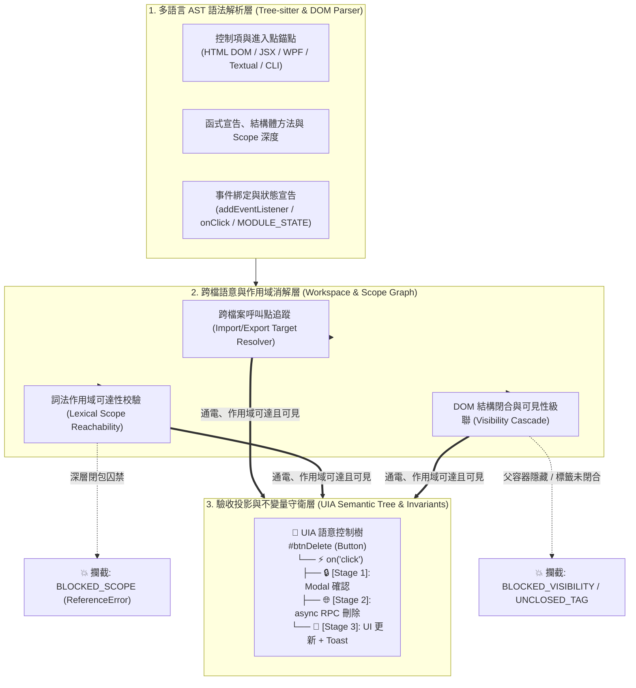
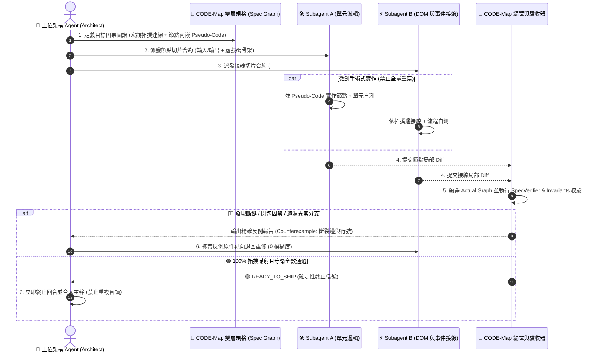
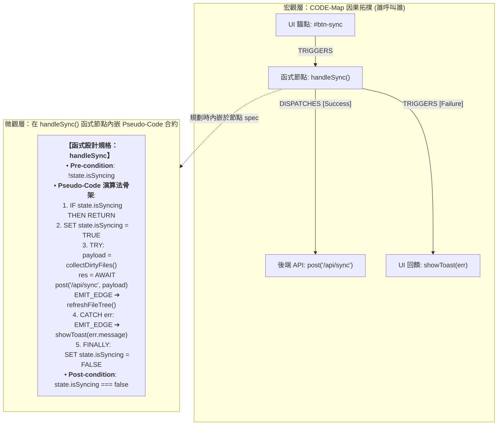
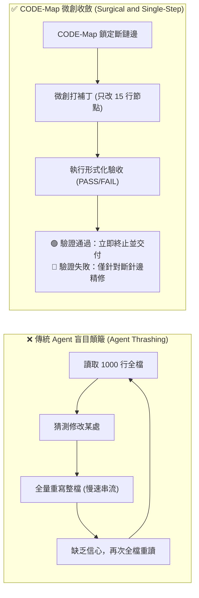

# 🌲 CODE-Map: Causal Operation & Dependency Evaluation Map

> **正式全稱**：**C**ausal **O**peration & **D**ependency **E**valuation **Map**（行為因果與接線依賴評估地圖引擎）  
> **核心定位**：AI Agent 與現代軟體工程的**「數位三用電表」與「形式化語意編譯器」**  
> **架構演進**：從 `AST (零件盤點)` ➔ `Call / DOM Graph (跨檔接線消解)` ➔ `CODE-Map 語意控制樹 (時空合一驗收)`  
>
> 📄 **權威技術白皮書**：[《為什麼軟體工程需要 CODE-Map？—— 三十五項頂級開源專案、699 個真實修復 Commits 的實戰驗證與形式化因果圖論白皮書》](docs/why_code_map_matters_35_repos_whitepaper.md)  
> 📘 **規格規劃指引**：[《CODE-Map 形式化規格規劃與 Subagent 派發指引：以微觀虛擬碼與宏觀因果圖譜建構雙層合約》](docs/SPEC_DRIVEN_PLANNING_GUIDE.md)  
> 🧭 **實戰使用手冊與邊界指南**：[《CODE-Map 實戰使用手冊與 AI Agent 協作邊界指南：可用領域、物理盲區與 LLM 接手標準程序》](docs/CODEMAP_LLM_USER_MANUAL.md)

---

## 🎯 第一章：為什麼需要 CODE-Map？（「函式無罪，流程要命」）

在現代 UI 與互動式軟體開發（特別是 AI Agent 協同開發）中，**絕大多數棘手的 Bug 都不是「單一函式演算法寫錯」，而是「跨時空的流程與接線斷裂」**。傳統工具與開發模式存在三大致命盲區：

1. **純 AST 只認語法零件，不識電路通電**：
   - 看得到按鈕（DOM）、看得到處理函式（Handler），但兩者之間到底有沒有綁定事件、目標函式是否被深鎖在無法觸及的內部閉包（執行期拋出 `ReferenceError`）、或者父層容器是否被 `hidden` / `display: none` 遮蔽（`BLOCKED_VISIBILITY`），純語法樹完全瞎子摸象。
2. **傳統 Git Diff 缺乏時空因果語意**：
   - 傳統 Diff 只告訴你「第 860 行新增了什麼字元」，卻看不出這次提交是否創造了**入度為 0 的孤立死代碼（`UNTRIGGERED_ACTION`）**，或破壞了非同步調用鏈與異常兜底分支。
3. **Agent Thrashing（代理人盲目顛簸死循環）**：
   - 由於缺乏「因果可觀測性」（像沒有三用電表的水電工），AI Agent 遇到畫面沒反應時，往往陷入**「讀取 1,000 行全檔 ➔ 憑空猜測修改 ➔ 慢吞吞全量重吐整檔 ➔ 再次全檔重讀」**的無窮死循環，不僅耗盡 Token，更因長文本注意力衰減改壞原本正常的邏輯。

**CODE-Map** 借鑒 Windows UI Automation (UIA) 的控制樹理念與形式化驗證（如 Lean 定理證明器）的契約思想，將程式碼投影為**「以控制項/進入點為錨點的語意因果圖」**，在規劃、實作與驗收階段提供確定性的數學守衛。

---

## 🏗️ 第二章：三層核心引擎架構



### 🌐 支援的 7 大主流語言與 8 種語意適配器
| 語言類別 | 適配器模組 | 支援副檔名 | 核心捕獲能力與形式化守衛 |
| :--- | :--- | :--- | :--- |
| **HTML / DOM** | [`html_adapter.py`](file:///d:/AntiGravity/UIA_Coder/uia_coder/adapters/html_adapter.py) | `.html`, `.htm` | DOM 階層樹（`CONTAINS`）、內聯事件接線（`TRIGGERS`）、外部腳本連結（`GROUNDS_TO`）、標籤閉合與 `hidden`/`display:none` 級聯阻斷（`BLOCKED_VISIBILITY`） |
| **JavaScript** | [`javascript_adapter.py`](file:///d:/AntiGravity/UIA_Coder/uia_coder/adapters/javascript_adapter.py) | `.js`, `.mjs`, `.cjs` | DOM 事件綁定、原型鏈方法、閉包作用域可達性、同步阻塞 API（`alert`/`confirm`）攔截 |
| **TypeScript / React** | [`typescript_adapter.py`](file:///d:/AntiGravity/UIA_Coder/uia_coder/adapters/typescript_adapter.py) | `.ts`, `.tsx` | React JSX 控制項錨點、Hooks 依賴鏈、IoC 裝飾器管線、狀態機轉移與非同步競態守衛 |
| **Python** | [`python_adapter.py`](file:///d:/AntiGravity/UIA_Coder/uia_coder/adapters/python_adapter.py) | `.py` | OOP 類別繼承、CLI 進入點、PyQt/Tkinter/Textual UI 控制項、主執行緒 `time.sleep` 凍結攔截 |
| **Rust** | [`rust_adapter.py`](file:///d:/AntiGravity/UIA_Coder/uia_coder/adapters/rust_adapter.py) | `.rs` | `struct` + `impl` 關聯方法消解、`#CLI: main` 進入點、`todo!()` / `unimplemented!()` / `panic!()` 危害攔截 |
| **Go** | [`go_adapter.py`](file:///d:/AntiGravity/UIA_Coder/uia_coder/adapters/go_adapter.py) | `.go` | 結構體接收器方法（Receiver Methods）、CLI 路由樹、`panic()` 與 `time.Sleep()` 阻塞攔截 |
| **C#** | [`csharp_adapter.py`](file:///d:/AntiGravity/UIA_Coder/uia_coder/adapters/csharp_adapter.py) | `.cs` | WPF / WinUI / Avalonia 事件綁定（`+=`）、控制項錨點、`Thread.Sleep()` 與 `NotImplementedException` 攔截 |

---

## 👑 第三章：Spec-Driven 多 Agent 形式化開發協議

現有多 Agent 架構（AutoGen、CrewAI 等）之所以在複雜軟體工程中頻繁翻車，是因為依賴**模糊的自然語言規格**與**不可靠的 LLM 肉眼 Code Review**。CODE-Map 將多 Agent 協作重構為**「以數學有向圖為契約」的四步閉環工業生產線**：



### 1️⃣ 第一步：雙層規約先行 —— 在函式節點中內嵌 Pseudo-Code 行為合約
> 📘 詳見完整規範：[《CODE-Map 形式化規格規劃與 Subagent 派發指引》](docs/SPEC_DRIVEN_PLANNING_GUIDE.md)

單純的拓撲圖只能保證「函式被呼叫到」，無法防禦「函式內部演算法走偏或吞掉異常」。因此在使用 CODE-Map 進行前置規劃時，上位架構 Agent 必須在 `TargetGraph` 中同時定義**「宏觀接線」與「函式內部 Pseudo-Code」**：



- **宏觀因果拓撲 (Macro Topology)**：定義節點間的接線（`TRIGGERS`, `DISPATCHES`, `GROUNDS_TO`），從圖論上消滅入度為 0 的死代碼與閉包阻隔。
- **微觀函式虛擬碼合約 (In-Node Pseudo-Code Contract)**：在規劃每個函式節點時，直接在節點的 `spec` 屬性放入結構化 `pseudo_code`、前後置條件與**「分支到邊的嚴格映射（Branch-to-Edge Mapping）」**，讓 Subagent 明確知道函式內部的演算法目標與每個分支必須觸發的下游節點：

```json
{
  "id": "func:handleSync",
  "name": "handleSync",
  "category": "ACTION",
  "file": "src/controllers/sync.js",
  "spec": {
    "summary": "處理使用者點擊同步的非同步流程與異常兜底",
    "inputs": ["event: ClickEvent", "activeWorkspace: string"],
    "outputs": ["Promise<SyncResult>"],
    "pre_conditions": ["activeWorkspace !== null", "!state.isSyncing"],
    "post_conditions": ["state.isSyncing === false"],
    "pseudo_code": [
      "IF state.isSyncing THEN RETURN EARLY",
      "SET state.isSyncing = TRUE",
      "TRY:",
      "  payload = CALL collectDirtyFiles(activeWorkspace)",
      "  res = AWAIT post('/api/sync', payload)",
      "  EMIT_EDGE: DISPATCHES -> refreshFileTree(res.data)",
      "CATCH error:",
      "  EMIT_EDGE: TRIGGERS -> showToast(error.message)",
      "FINALLY:",
      "  SET state.isSyncing = FALSE"
    ],
    "branch_to_edge_mapping": {
      "on_success": "refreshFileTree",
      "on_catch": "showToast"
    }
  }
}
```

### 2️⃣ 第二步：反顛簸協定與微創手術式補丁 (Anti-Thrashing Protocol)
為了終結 Agent「讀全檔 ➔ 改一點 ➔ 重讀全檔 ➔ 慢速重吐整檔」的顛簸死循環，所有 Agent 必須遵守三大鐵律：



1. **節點切片讀取 (`--slice` / `--bundle`)**：禁止盲目讀取千行大檔，只提取目標節點及其相鄰因果邊的原始碼切片，將 Context 雜訊降為零。
2. **微創打補丁 (Surgical Node-Level Patching)**：嚴禁全量重寫檔案。所有變更必須限定在目標節點（函式/方法）邊界內局部替換（`edit_file`），輸出 Token 減少 95%，修改時間從 120 秒降至 3 秒。
3. **確定性終止信號 (Deterministic Stopping Condition)**：修改後立即執行 `codemap.py --verify-spec` 或 `pytest`。**只要驗證通過（PASS），立即終止回合並交付**，嚴禁出於「不放心」而再次重讀全檔；若失敗（FAIL），僅針對反例指出的斷鏈邊靶向修正。

### 3️⃣ 第三步：雙向規格異議機制 (Spec Negotiation)
> **規格圖譜是契約，但不是聖旨。** 若前期規格設計有誤，單向強制驗收只會逼 Subagent 硬湊出「圖譜全綠、功能錯誤」的代碼。

當 Subagent 實作時發現既有架構與規格衝突，可提交結構化的 **規格異議報告 (`Spec Objection`)**，並由 CODE-Map 的 `--verify-objection` 自動對源碼進行 AST 防偽查證：

```yaml
objection:
  spec_version: 3
  target: "edge: confirmModal.onConfirm -> deleteItem"   # 受質疑的節點或邊
  reason: "後端刪除為批次 API，逐筆呼叫會造成 N 次請求與部分失敗不一致"
  evidence: "api/items.ts:L42 只提供 deleteMany(ids)"    # 由 --verify-objection 自動查驗 AST 真偽
  proposal: "改為 confirmModal.onConfirm -> deleteItems(ids) -> api.deleteMany"
  impact: ["#btnDelete", "#btnBulkDelete"]                 # 受影響之 UI 錨點
```

---

## 🚀 第四章：快速上手與 CLI 武器庫 (Quick Start)

CODE-Map 提供統一的命令列入口 [`codemap.py`](file:///d:/AntiGravity/UIA_Coder/codemap.py)，支援單檔分析、跨檔工作區建圖、節點切片打包、規格偏序驗收與視覺化儀表板：

```powershell
# 1. 查詢目前已支援的所有程式語言與副檔名
python.exe -X utf8 codemap.py --list-languages

# 2. 單一檔案語意控制樹分析與形式化不變量守衛檢驗 (--check 違規時返回非 0 狀態碼)
python.exe -X utf8 codemap.py --file "src/sample_go_app.go" --check

# 3. 跨檔案 / 整個專案目錄聯合建圖 (自動消解跨模組 import/export 依賴鏈)
python.exe -X utf8 codemap.py --dir "uia_coder" --check

# 4. 節點前向切片與原始碼精準打包 (提供給 Subagent 的零雜訊 Context)
python.exe -X utf8 codemap.py --file "legacy/workspaceFileTree.js" --slice "#btnDelete"
python.exe -X utf8 codemap.py --file "legacy/workspaceFileTree.js" --bundle "#btnDelete"

# 5. 上位規格契約偏序驗收 (比對 Target Spec 與實際代碼是否 100% 通電吻合)
python.exe -X utf8 codemap.py --file "legacy/workspaceFileTree.js" --verify-spec "spec.json"

# 6. Subagent 規格異議 AST 防偽查證
python.exe -X utf8 codemap.py --verify-objection "objection.yaml" --repo "."

# 7. 雙檔案或 Git 歷史 Commits 語意圖譜差分 (Semantic Graph Diff)
python.exe -X utf8 codemap.py --diff-files "legacy/workspaceFileTree_buggy.js" "legacy/workspaceFileTree.js" --check
python.exe -X utf8 codemap.py --file "uia_coder/core/graph.py" --git-diff HEAD~1

# 8. 導出雙欄互動式 HTML 視覺化儀表板 (點擊圖譜節點平滑滾動並高亮對應源碼)
python.exe -X utf8 codemap.py --file "legacy/workspaceFileTree.js" --html "reports/dashboard.html"

# 9. 執行全套自動化測試套件 (含多語言引擎、HTML DOM 級聯、跨檔消解與規格驗收)
python.exe -X utf8 -m pytest tests/
```

---

## 🏆 第五章：實戰驗證與基準測試（35 大頂級開源專案 × 699 Commits）

CODE-Map 已經過橫跨 **10 大現代軟體架構領域、35 個頂級開源專案、699 個真實 Bug 修復 Commits（共 920 個修改檔案）** 的嚴苛基準實測：
- **可執行邏輯變更捕獲率**：**100.0% (818 / 818)**（其餘 102 個為純註釋、型別宣告或文檔微調，由 AST 去噪指紋精準過濾）。
- **萬級節點樹崩潰率**：**0.0%**（全面採用 `TreeCursor` 原生迭代與程序隔離技術）。

| 架構領域支柱 | 驗證開源專案（語言） | 審查規模 (Commits / Files) | 可執行邏輯捕獲率 | 核心驗證場景 |
| :--- | :--- | :---: | :---: | :--- |
| **1. 終端 TUI 五大語言滿貫** | `textual` (Py), `ink` (TS), `ratatui` (Rust), `bubbletea` (Go), `spectre.console` (C#) | 100 / 148 | **100.0%** | 終端事件迴圈、按鍵綁定、非同步訊息派發、畫面緩衝區重繪 |
| **2. 跨平台桌面 GUI 與視覺樹** | `Avalonia` (C#), PyQt/Tkinter 實戰案例 (Py) | 20 / 30 | **100.0%** | 視覺樹/邏輯樹路由事件冒泡、StyledProperty、UI 執行緒阻塞攔截 |
| **3. 前端 DOM 與響應式微核心** | `todomvc` (JS), `Sortable` (JS), `alpine` (JS), `preact` (JS), `vue-core` (TS) | 99 / 127 | **100.0%** | 原生拖曳事件、Virtual DOM Diff、Proxy 響應式依賴追蹤、DOM 可見性 |
| **4. 高性能非同步 Web 路由** | `fastapi` (Py), `gin` (Go), `axum` (Rust) | 60 / 66 | **100.0%** | 前綴樹路由分發、ASGI / Tower 中介軟體管線、依賴注入消解 |
| **5. 企業級 IoC 與裝飾器管線** | `nestjs` (TS), `pydantic` (Py) | 40 / 46 | **100.0%** | Guards / Interceptors 管線、Request-scoped DI、資料模型驗證器 |
| **6. 狀態機與全域不可變 Store** | `xstate` (TS), `zustand` (TS) | 40 / 49 | **100.0%** | 有限狀態機轉移守衛、閉包不可變性、非同步 Persist 競態防護 |
| **7. 企業級 ORM 與連線池管理** | `efcore` (C#), `go-redis` (Go), `httpx` (Py), `RestSharp` (C#) | 80 / 107 | **100.0%** | LINQ 運算式樹、連線池狀態機、非同步超時與髒連線回滾 |
| **8. AI 大模型推理與平行計算** | `vllm` (Py), `polars` (Rust) | 40 / 62 | **100.0%** | PagedAttention 排程器死鎖防護、Rayon 平行算子與 Arrow 記憶體管線 |
| **9. 全端 SSR、RPC 與編譯打包** | `next.js` (TS), `trpc` (TS), `vite` (TS) | 60 / 74 | **100.0%** | Server Actions 跨端接線、端到端型別 RPC 路由、HMR 熱重載廣播 |
| **10. 雲原生代理、CLI 與 ECS 引擎** | `caddy` (Go), `traefik` (Go), `bevy` (Rust), `zellij` (Rust), `ripgrep` (Rust), `bat` (Rust), `fzf` (Go), `cobra` (Go) | 160 / 211 | **100.0%** | 自動 TLS 重載、動態邊緣路由、ECS 並發排程、Actor IPC、CLI 命令樹 |

> 📊 完整數據與逐案剖析請參閱：[《三十五項開源專案 699 Commits 形式化驗證白皮書》](docs/why_code_map_matters_35_repos_whitepaper.md) 與 [綜合評估報告 (`reports/dogfooding_benchmark_35_repos.md`)](reports/dogfooding_benchmark_35_repos.md)。

---

## 📂 第六章：專案目錄結構與演進藍圖

```text
d:\AntiGravity\UIA_Coder\
├── codemap.py                             # 🌲 CODE-Map 官方統一 CLI 入口
├── AGENTS.md                              # 🛡️ AI Agent 協同開發規範與反顛簸協定 (Anti-Thrashing Protocol)
├── README.md                              # 📖 專案核心架構與全景指引 (本文件)
├── uia_coder/                             # 🧠 CODE-Map 核心引擎套件
│   ├── core/                              # 語言無關圖論與形式化驗證核心
│   │   ├── graph.py                       # UIACodeGraph (有向圖結構、不變量守衛、切片與源碼打包)
│   │   ├── differ.py                      # UIAGraphDiffer (語意圖譜差分、AST 去噪指紋、增量違規判定)
│   │   ├── spec_verifier.py               # SpecVerifier (上位規格契約偏序驗收 & Subagent 異議 AST 查證)
│   │   ├── workspace_graph.py             # WorkspaceGraphBuilder (跨檔案 Import/Export 符號消解與聯合建圖)
│   │   └── base_adapter.py                # BaseUIAGraphBuilder (多語言適配器抽象基底與去噪指紋計算)
│   ├── adapters/                          # 🔌 多語言 AST 語意適配器 (Strategy & Registry Pattern)
│   │   ├── html_adapter.py                # 🌐 HTML/DOM 結構樹、標籤閉合與可見性級聯適配器
│   │   ├── javascript_adapter.py          # 🟨 JavaScript DOM / 原型鏈 / 閉包作用域適配器
│   │   ├── typescript_adapter.py          # 🟦 TypeScript / React TSX / 狀態機適配器
│   │   ├── python_adapter.py              # 🐍 Python OOP / CLI / PyQt / Textual 適配器
│   │   ├── rust_adapter.py                # 🦀 Rust Struct Impl / CLI / Panic-Todo 守衛適配器
│   │   ├── go_adapter.py                  # 🐹 Go Receiver / CLI / Panic-Sleep 守衛適配器
│   │   └── csharp_adapter.py              # 🎯 C# WPF / WinUI / Avalonia 事件綁定適配器
│   ├── reporters/                         # 📊 視覺化報告生成器
│   │   └── html_reporter.py               # 雙欄互動式 HTML 語意控制樹儀表板
│   └── cli.py                             # 🚀 命令列參數路由與功能整合
├── docs/                                  # 📚 架構設計規範與理論白皮書
│   ├── CODEMAP_LLM_USER_MANUAL.md         # 🧭 實戰使用手冊：可用領域、物理盲區與 LLM 協作 SOP
│   ├── SPEC_DRIVEN_PLANNING_GUIDE.md      # 雙層規約架構 (Macro Topology + Micro Pseudo-Code) 實戰指南
│   ├── CODEMAP_NEXT_PHASE_TODO.md         # 靜態分析引擎進階演進與紅隊審計修復清單
│   └── why_code_map_matters_35_repos_whitepaper.md # 35 專案 699 Commits 形式化因果圖論白皮書
├── tests/                                 # 🧪 自動化回歸測試套件 (18 項核心測試 100% PASS)
│   ├── test_graph_engine.py               # 多語言圖譜構建、差分與不變量守衛測試
│   ├── test_html_adapter.py               # HTML DOM 階層、未閉合標籤與隱藏屬性級聯測試
│   ├── test_next_phase_features.py        # 跨檔依賴消解、SpecVerifier 偏序驗收與異議防偽測試
│   └── test_workspace_commits.py          # 真實 Git 歷史提交語意差分驗收測試
├── tools/                                 # 🛠️ 大規模開源專案基準探勘與稽核工具群
└── reports/                               # 📈 基準測試報告與互動式 HTML 視覺化產出
```

### 🗺️ 演進路線圖 (Roadmap)
- [x] **Phase 1：多語言 AST 因果圖譜引擎**：完成 JS, TS/TSX, Python, Rust, Go, C#, HTML/DOM 共 8 種語法適配器與 35 大開源專案（699 Commits）100% 捕獲率實證。
- [x] **Phase 2：跨檔案消解與形式化規格閉環**：落地 `WorkspaceGraphBuilder` 跨檔依賴接合、`SpecVerifier` 契約驗收、`--verify-objection` 異議防偽查證、以及 AST 去噪指紋與增量不變量守衛。
- [x] **Phase 3：雙層規約與反顛簸開發協議**：確立「宏觀因果拓撲 + 節點內嵌 Pseudo-Code」雙層規範，並制定微創手術式補丁與確定性終止協定。
- [ ] **Phase 4：封裝為原生 MCP Server**：將 `--slice`、`--bundle`、`--verify-spec` 封裝為標準 MCP 工具，供各類 Coding Agent 在對話中直接調用。
- [ ] **Phase 5：虛擬碼 AST 骨架深度校驗器 (Skeleton Verifier)**：自動比對節點 `pseudo_code` 中的 `TRY/CATCH/FINALLY` 分支映射與實際源碼 AST 結構是否嚴格同構。
