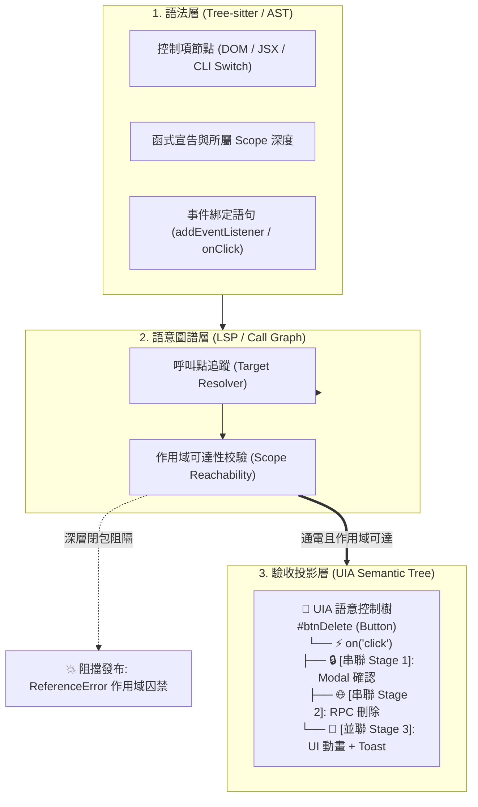

# 🌲 CODE-Map: Causal Operation & Dependency Evaluation Map

> **正式全稱**：**C**ausal **O**peration & **D**ependency **E**valuation **Map**（行為因果與接線依賴評估地圖引擎）  
> **核心架構願景**：從 `AST (零件盤點)` ➔ `Call Graph (接線消解)` ➔ `CODE-Map 語意控制樹 (時空合一驗收)`  
> **獨立自專案**：`d:\AntiGravity\Agent-Study`（會話 ID：`394096b1-bc18-40c1-8189-21c4f485bf2d`）

---

## 🎯 為什麼需要 CODE-Map？

在現代 UI 與互動式軟體開發中，傳統的代碼分析工具存在致命盲區：
1. **純 AST 只認語法，不識接線**：看得到按鈕、看得到函式，但兩者中間到底有沒有通電，AST 完全瞎子摸象。
2. **表面正則匹配給出虛假安全感**：只要代碼裡寫了 `.addEventListener` 就以為接線成功，卻看不出目標函式被深鎖在兄弟閉包內部（執行期直接拋出 `ReferenceError`）。
3. **傳統 Git Diff 缺乏語意**：只告訴你第 860 行加了什麼，看不出這次提交是否破壞了「空間上的控制項樹」或「時間上的非同步因果鏈」。

**CODE-Map** 借鑒 Windows UI Automation (UIA) 的層級理念與 Aider 的 `repomap.py` 模式，將代碼變更投影為**「以 UI 控制項為錨點的語意控制樹」**，在發布前自動進行接線驗收與形式化守衛。

---

## 🏗️ 核心架構圖



---

## 📂 專案結構與遷移資產

```text
d:\AntiGravity\UIA_Coder\
├── codemap.py                       # 🌲 CODE-Map 官方統一命令列入口 (Official CLI)
├── uia_coder/                       # 🧠 CODE-Map 核心引擎套件 (Core & Adapters)
│   ├── core/                        # 語言無關圖論運算層
│   │   ├── graph.py                 # UIACodeGraph (NetworkX 圖結構、切片、驗收)
│   │   ├── differ.py                # ⚡ UIAGraphDiffer (圖譜語意差分與代碼對照引擎)
│   │   └── base_adapter.py          # BaseUIAGraphBuilder (適配器抽象介面)
│   ├── adapters/                    # 🔌 語言專屬語意解析層 (Strategy / Registry)
│   │   ├── __init__.py              # 語言註冊中心與自動路由工廠
│   │   ├── javascript_adapter.py    # JavaScript DOM / ES6 閉包適配器
│   │   ├── typescript_adapter.py    # TypeScript / React TSX 適配器
│   │   └── python_adapter.py        # Python OOP、CLI 入口與 PyQt 守衛適配器
│   ├── cli.py                       # 🚀 命令列介面邏輯實作
│   └── __main__.py                  # 支援 python -m uia_coder 執行模組
├── tests/                           # 🧪 自動化測試套件
│   ├── test_graph_engine.py         # 多語言圖譜構建與狀態躍遷測試 (Tests 0-5)
│   └── test_workspace_commits.py    # 真實 Git 倉庫歷史 Commits 語意驗收測試
├── tools/                           # 🛠️ 輔助開發與探勘工具
│   ├── codemap_miner.py             # ⛏️ Git 倉庫歷史 Commits 探勘評估引擎
│   └── generate_interactive_report.py # 雙欄互動式 HTML 儀表板生成器
├── legacy/                          # 📦 歷史封存 (早期原型與過渡轉發墊片)
│   ├── uia_graph_engine.py          # 早期向後相容墊片 (已模組化至 uia_coder)
│   └── uia_code_diff.py             # 第一代正則差分原型
├── vendor/
│   └── aider/repomap.py             # Aider 官方 RepoMap 參考實作
├── reports/                         # 生成之 HTML 視覺化儀表板
├── AGENTS.md                        # Antigravity 專案規則與環境規範
└── README.md                        # 本專案架構與使用指引
```

---

## 🚀 快速上手 (Quick Start)

### 1. 執行 CODE-Map CLI 引擎
支援傳入 `.js`、`.ts`、`.tsx` 或 `.py` 檔案，引擎會**自動辨識副檔名並調用對應語言適配器**：
```powershell
# 查詢目前已支援之程式語言 (已支援 JavaScript, Python, TypeScript)
python.exe -X utf8 codemap.py --list-languages

# 分析單一檔案並驗收 (直接輸出極簡 UIA 語意控制樹)
python.exe -X utf8 codemap.py --file "src/workspaceFileTree.js" --check

# 比對兩個檔案之間的語意圖譜差分 (Parent 規格書 vs Subagent 實作代碼)
python.exe -X utf8 codemap.py --diff-files "src/workspaceFileTree_buggy.js" "src/workspaceFileTree.js" --check

# 比對指定檔案在 Git 歷史中的 UIA 語意差分
python.exe -X utf8 codemap.py --file "src/workspaceFileTree.js" --git-diff "HEAD~1"

# ⛏️ 執行 GitHub 倉庫自動探勘 (批次審查帶有 fix/perf 之 Commit 並產出天梯報告)
python.exe -X utf8 codemap_miner.py --repo "D:\path\to\repo" --max 10 --output "reports/benchmark.md"

# 執行全套多語言自動化測試 (含 UIA-Diff)
python.exe -X utf8 test_graph_engine.py
```

### 2. 執行 UIA 代碼差分驗收工具
分析指定 Git 倉庫的變更，並輸出 Markdown 報告與 HTML 儀表板：
```powershell
python.exe -X utf8 uia_code_diff.py --repo "D:\path\to\your\repo" --diff "HEAD~1" --html "reports/diff.html"
```

### 3. 開啟 Marimo 反應式筆記本 (Living Executable Docs)
啟動側邊欄面板或直接於瀏覽器編輯互動式審查引擎：
```powershell
python.exe -X utf8 -m marimo edit ".marimo/394096b1-bc18-40c1-8189-21c4f485bf2d/marimo_session.py"
```

---

## 🛡️ 已驗證的真實案例 (Case Study)

* **JavaScript (Commit `df3cc5f` & `a1995e4`)**：
  * 成功攔截 `init()` 內部閉包囚禁造成的 `ReferenceError` 與 `window.confirm` 阻塞。
  * 修復後通過驗收，前向切片精準捕獲非同步 `[await]` 調用鏈。
* **Python (PyQt & Tkinter GUI)**：
  * 成功攔截槽函式被深鎖在 `setup_ui()` 內部導致外部無效連接的死穴。
  * 成功抓出 UI 主執行緒中的 `time.sleep()` 介面凍結危害（`🔴 BLOCKED_BY_INVARIANTS`）。
  * 修復至模組/類別可達作用域後亮綠燈（`🟢 READY_TO_SHIP`）。

---

## 🗺️ 後續迭代藍圖

1. [x] **整合 Tree-sitter AST 解析與 NetworkX 有向圖**：已於 `uia_coder` 落地，支援現代 Scope Stack 與閉包阻隔消解。
2. [x] **模組化多語言架構 (Adapter & Registry Pattern)**：將圖論核心與語意適配器徹底解耦，支援依副檔名自動分發。
3. [x] **支援雙語言 (JavaScript + Python)**：支援 JS DOM/閉包與 Python PyQt 信號槽/UI 阻塞危害檢測。
4. [x] **加入 UI 錨點圖切片 (Graph Slicing)**：`forward_slice(anchor_id)` 可從 UI 控制項向下切出受影響的完整因果子圖。
5. [x] **標準化 Node-Link 序列化**：支援 `to_node_link_data()`，為 MCP Tool 與 Agent 協議提供零成本格式互轉。
6. [ ] **封裝為 Agent MCP Tool**：提供給 Claude / Gemini 等 Coding Agent 即時調用圖譜與驗收能力。
7. [ ] **擴充 TypeScript (TSX / React) 與 C# (WinUI / WPF)** 適配器。
