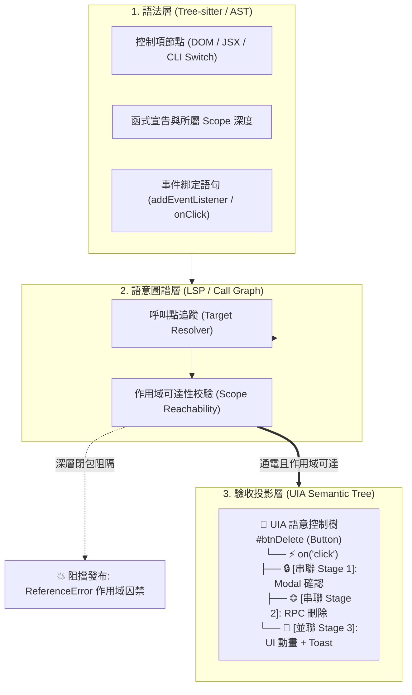
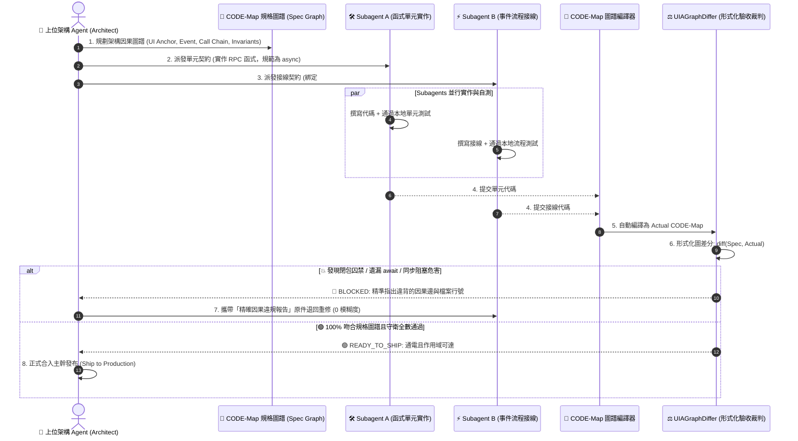
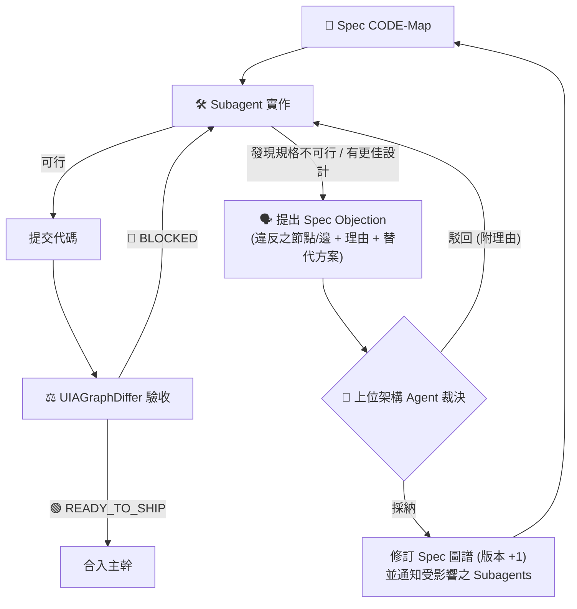

# 🌲 CODE-Map: Causal Operation & Dependency Evaluation Map

> **正式全稱**：**C**ausal **O**peration & **D**ependency **E**valuation **Map**（行為因果與接線依賴評估地圖引擎）  
> **核心架構願景**：從 `AST (零件盤點)` ➔ `Call Graph (接線消解)` ➔ `CODE-Map 語意控制樹 (時空合一驗收)`  
> **獨立自專案**：`d:\AntiGravity\Agent-Study`（會話 ID：`394096b1-bc18-40c1-8189-21c4f485bf2d`）  
> 
> 📄 **權威技術白皮書**：[《為什麼軟體工程需要 CODE-Map？—— 三十五項頂級開源專案、699 個真實修復 Commits 的實戰驗證與形式化因果圖論白皮書》](docs/why_code_map_matters_35_repos_whitepaper.md) (推薦必讀)

---

## 🎯 為什麼需要 CODE-Map？

在現代 UI 與互動式軟體開發中，傳統的代碼分析工具存在致命盲區：
1. **純 AST 只認語法，不識接線**：看得到按鈕、看得到函式，但兩者中間到底有沒有通電，AST 完全瞎子摸象。
2. **表面正則匹配給出虛假安全感**：只要代碼裡寫了 `.addEventListener` 就以為接線成功，卻看不出目標函式被深鎖在兄弟閉包內部（執行期直接拋出 `ReferenceError`）。
3. **傳統 Git Diff 缺乏語意**：只告訴你第 860 行加了什麼，看不出這次提交是否破壞了「空間上的控制項樹」或「時間上的非同步因果鏈」。

**CODE-Map** 借鑒 Windows UI Automation (UIA) 的層級理念與 Aider 的 `repomap.py` 模式，將代碼變更投影為**「以 UI 控制項為錨點的語意控制樹」**，在發布前自動進行接線驗收與形式化守衛。

---

## 🏗️ 核心架構圖



---

## 👑 終極架構願景：反向規格驅動的多 Agent 形式化驗收閉環 (Spec-Driven Multi-Agent Closed Loop)

### 💥 為什麼現有 Multi-Agent 系統無法開發複雜軟體？
當前業界的多 Agent 開發架構（如 AutoGen、CrewAI、ChatDev 等）存在三大致命瓶頸：
1. **自然語言規格的模糊性**：上位 Agent 給出的文字需求充滿歧義，Subagent 實作時容易產生幻覺，擅自將函式封閉在局部閉包中，或遺漏非同步 `await` 接線。
2. **大模型「肉眼 Review」的不可靠性**：上位 Agent 拿著 Subagent 寫好的數百行代碼進行文字審查，根本無法靜態識破深層閉包囚禁（`ReferenceError`）與非同步競態死穴。
3. **單元測試會說謊**：Subagent 寫的單元測試常依賴過度 Mock，單元測試全部綠燈，但組裝回 UI 主幹時一按按鈕依然直接崩潰。

### 🚀 CODE-Map 的反向工業化生產線 (Graph as Contract)
CODE-Map 的終極目標不是事後被動分析代碼，而是**「反過來做」——以數學有向圖作為多 Agent 協同的不可違抗規格契約**：



### 🔁 三階段閉環流程：
1. **規格定義 (Spec Planning)**：
   * 上位 Agent 規劃出不可違抗的 `Spec CODE-Map`，明確定義 UI 控制項錨點（如 `#btnDelete`）、觸發事件（`on('click')`）、非同步調用鏈與形式化守衛（`NO_SYNC_BLOCKING`、`SCOPE_ACCESSIBLE`）。
2. **分解派發與並行自測 (Decomposition & Self-Testing)**：
   * **Subagent A** 專注於底層單元邏輯，自跑單元測試。
   * **Subagent B** 專注於事件接線與業務流程，自跑流程測試。
3. **形式化驗收與自動重派修復 (Deterministic Acceptance & Self-Correction)**：
   * 所有 Subagents 完成代碼後，上位 Agent 調用 CODE-Map 編譯器將聚合源碼抽取為 `Actual CODE-Map`。
   * 透過 `UIAGraphDiffer` 進行純數學比對。若不符規格或觸發守衛紅牌，上位 Agent **不需要人工介入，直接帶著圖譜違規點將任務退回給責任 Subagent 重新修正**，直到全綠燈放行！

### 🧩 雙層規約架構：為什麼節點中必須內嵌 Pseudo-Code？(Two-Tier Specification)

> 📘 **詳細技術指引**：[《CODE-Map 形式化規格規劃與 Subagent 派發指引：以微觀虛擬碼與宏觀因果圖譜建構雙層合約》](docs/SPEC_DRIVEN_PLANNING_GUIDE.md)

單純的宏觀拓撲圖能保證「函式必定通電被呼叫到」，但無法防禦「函式內部演算法走偏或遺漏兜底分支」。因此，CODE-Map 規範在規劃 Target Graph 時，所有流程與動作節點必須內嵌結構化 **Pseudo-Code 行為合約**：

1. **宏觀因果拓撲 (Macro Topology)**：定義節點間的接線（TRIGGERS, DISPATCHES, GROUNDS_TO），從圖論數學上消除死代碼、孤立函式與閉包阻隔。
2. **微觀行為合約 (Micro Behavioral Contract)**：在節點 spec 屬性中內嵌演算法虛擬碼、前後置條件（Pre/Post-conditions）以及**「分支到邊的嚴格映射（Branch-to-Edge Mapping）」**：
   - 虛擬碼中每一個 TRY / CATCH / FINALLY 或 IF / ELSE 分支，必須明確標註對應圖譜中的哪一條出邊（Outgoing Edge）。
   - 例如：CATCH error ➔ EMIT_EDGE: TRIGGERS ➔ showToast(error)，杜絕吞掉異常的空 catch 區塊。
3. **AST 骨架級驗收 (Skeleton Verification)**：CODE-Map 不僅驗證呼叫關係，還靜態掃描 AST 是否具備對應的分支結構與狀態復原副作用，達成時空雙維度的嚴密閉環。

### 🗣️ Subagent 異議機制：規格可被挑戰 (Spec Negotiation)

> **規格圖譜是契約，但不是聖旨。** 前期設計必然存在想錯之處，往往要到實作時才會暴露（瀑布式開發的老教訓）。若閉環只允許「上位 Agent 單向退件」，Subagent 只能硬湊代碼去迎合一份錯誤的規格，最終產出「圖譜全綠、功能錯誤」的結果。

因此閉環必須是**雙向**的：Subagent 除了「實作」與「被退件」之外，還擁有第三種合法回應——**提出規格異議 (Spec Objection)**。



**異議報告的最低格式**（結構化，避免淪為模糊的「做不到」）：

```yaml
objection:
  spec_version: 3
  target: "edge: confirmModal.onConfirm -> deleteItem"   # 受質疑的節點或邊
  reason: "後端刪除為批次 API，逐筆呼叫會造成 N 次請求與部分失敗不一致"
  evidence: "api/items.ts:L42 只提供 deleteMany(ids)"
  proposal: "改為 confirmModal.onConfirm -> deleteItems(ids) -> api.deleteMany"
  impact: ["#btnDelete", "#btnBulkDelete"]                 # 受影響之 UI 錨點
```

**裁決原則：**
1. **上位 Agent 保有最終決定權**，但駁回必須附理由，避免 Subagent 無限重試同一錯誤方向。
2. **規格修訂需版本化**：每次採納異議即遞增 `spec_version`，並對受影響錨點之所有 Subagents 廣播，防止各自依據不同版本實作。
3. **異議與退件分開計數**：同一節點反覆出現異議，代表規格設計本身有問題，應升級為人類架構師審查。

---

## 📂 專案結構與遷移資產

```text
d:\AntiGravity\UIA_Coder\
├── codemap.py                       # 🌲 CODE-Map 官方統一命令列入口 (Official CLI)
├── uia_coder/                       # 🧠 CODE-Map 核心引擎套件 (Core & Adapters)
│   ├── core/                        # 語言無關圖論運算層
│   │   ├── graph.py                 # UIACodeGraph (NetworkX 圖結構、切片、驗收)
│   │   ├── differ.py                # ⚡ UIAGraphDiffer (圖譜語意差分與代碼對照引擎)
│   │   └── base_adapter.py          # BaseUIAGraphBuilder (適配器抽象介面)
│   ├── adapters/                    # 🔌 語言專屬語意解析層 (Strategy / Registry)
│   │   ├── __init__.py              # 語言註冊中心與自動路由工廠
│   │   ├── javascript_adapter.py    # JavaScript DOM / 原型鏈 / Backbone-Spine 事件適配器
│   │   ├── typescript_adapter.py    # TypeScript / React TSX 適配器
│   │   ├── python_adapter.py        # Python OOP、CLI 入口、PyQt 與 Textual 裝飾器適配器
│   │   ├── rust_adapter.py          # 🦀 Rust 結構體關聯方法、CLI 進入點與巨集危害適配器
│   │   ├── go_adapter.py            # 🐹 Go 接收器方法、CLI 進入點與 panic/sleep 危害適配器
│   │   └── csharp_adapter.py        # 🎯 C# WPF/WinUI 事件綁定、CLI 與 Thread.Sleep 危害適配器
│   ├── cli.py                       # 🚀 命令列介面邏輯實作
│   └── __main__.py                  # 支援 python -m uia_coder 執行模組
├── docs/                            # 📚 官方權威文檔與研究白皮書
│   └── why_code_map_matters_35_repos_whitepaper.md # 🏆 三十五項開源專案 699 Commits 形式化驗證白皮書
├── src/                             # 📄 多語言範例代碼 (JS/Python/Rust/Go/C#)
│   ├── sample_rust_app.rs           # 🦀 Rust 範例程式 (包含 todo! 危害攔截示範)
│   ├── sample_go_app.go             # 🐹 Go 範例程式 (包含 panic/time.Sleep 示範)
│   └── sample_csharp_app.cs         # 🎯 C# 範例程式 (包含 WPF 事件接線與 Thread.Sleep 示範)
├── tests/                           # 🧪 自動化測試套件
│   ├── test_graph_engine.py         # 多語言圖譜構建、差分與全語言驗收測試 (Tests 0-8)
│   └── test_workspace_commits.py    # 真實 Git 倉庫歷史 Commits 語意驗收測試
├── tools/                           # 🛠️ 輔助開發與探勘工具
│   ├── audit_todomvc_20_flow_bugs.py # 🌲 TodoMVC 20 個真實流程錯誤基準測試工具
│   ├── audit_textual_20_flow_bugs.py # 🐍 Textual 20 個真實核心修復基準測試工具
│   ├── audit_sortable_20_flow_bugs.py # 🔀 SortableJS 20 個原生拖曳事件基準測試工具
│   ├── audit_xstate_20_flow_bugs.py  # ⚙️ XState 20 個狀態機轉移基準測試工具
│   ├── audit_triple_benchmark.py     # 🏆 Ink + HTTPX + Alpine 三大專案綜合稽核套件
│   ├── audit_rust_go_benchmark.py    # 🦀 Ratatui (Rust) + 🐹 Bubbletea (Go) 綜合稽核套件
│   ├── audit_csharp_cobra_benchmark.py # 🎯 Spectre.Console (C#) + 🐍 Cobra (Go) 綜合稽核套件
│   ├── audit_preact_vue_benchmark.py # ⚡ Preact (VDOM) + 💚 Vue 3 (Reactivity) 綜合稽核套件
│   ├── audit_web_cli_quad_benchmark.py # 🌐 FastAPI + Gin + ⚡ ripgrep + fzf 四大專案綜合稽核套件
│   ├── audit_csharp_rust_expansion_benchmark.py # 🚀 Avalonia + RestSharp (C#) + bat + axum (Rust) 擴展套件
│   ├── audit_ultimate_six_benchmark.py # 🔥 NestJS + Zustand + go-redis + Zellij + Polars + EF Core 旗艦稽核套件
│   ├── audit_frontier_eight_benchmark.py # 🌟 pydantic + vLLM + trpc + Vite + Next.js + Caddy + Traefik + Bevy 稽核套件
│   ├── codemap_miner.py             # ⛏️ Git 倉庫歷史 Commits 探勘評估引擎
│   └── generate_interactive_report.py # 雙欄互動式 HTML 儀表板生成器
├── legacy/                          # 📦 歷史封存 (早期原型與過渡轉發墊片)
│   ├── uia_graph_engine.py          # 早期向後相容墊片 (已模組化至 uia_coder)
│   └── uia_code_diff.py             # 第一代正則差分原型
├── vendor/
│   └── aider/repomap.py             # Aider 官方 RepoMap 參考實作
├── reports/                         # 生成之 HTML 視覺化儀表板與評估報告
│   ├── dogfooding_benchmark_35_repos.md # 🏆 跨 35 大開源專案 699 Commits 實戰驗證綜合報告 (全領域覆蓋)
│   ├── dogfooding_benchmark_27_repos.md # 跨 27 大開源專案 539 Commits 實戰驗證綜合報告
│   ├── dogfooding_benchmark_21_repos.md # 跨 21 大開源專案 419 Commits 實戰驗證綜合報告
│   ├── dogfooding_benchmark_17_repos.md # 跨 17 大開源專案 339 Commits 實戰驗證綜合報告
│   ├── dogfooding_benchmark_13_repos.md # 跨 13 大開源專案 259 Commits 實戰驗證報告
│   ├── dogfooding_benchmark_11_repos.md # 跨 11 大開源專案 219 Commits 實戰驗證報告
│   ├── dogfooding_benchmark_9_repos.md # 跨 9 大開源專案 179 Commits 實戰驗證報告
│   ├── dogfooding_benchmark_7_repos.md # 跨 7 大開源專案 139 Commits 實戰驗證報告
│   └── dogfooding_experience_todomvc_textual.md # TodoMVC 與 Textual 雙戰場早期報告
├── AGENTS.md                        # Antigravity 專案規則與環境規範
└── README.md                        # 本專案架構與使用指引
```

---

## 🚀 快速上手 (Quick Start)

### 1. 執行 CODE-Map CLI 引擎
支援傳入 `.js`、`.ts`、`.tsx`、`.py`、`.rs`、`.go` 或 `.cs` 檔案，引擎會**自動辨識副檔名並調用對應語言適配器**：
```powershell
# 查詢目前已支援之程式語言 (已支援 JavaScript, TypeScript, Python, Rust, Go, C#)
python.exe -X utf8 codemap.py --list-languages

# 分析單一檔案並驗收 (直接輸出極簡 UIA 語意控制樹)
python.exe -X utf8 codemap.py --file "src/sample_go_app.go" --check

# 比對兩個檔案之間的語意圖譜差分 (Parent 規格書 vs Subagent 實作代碼)
python.exe -X utf8 codemap.py --diff-files "legacy/workspaceFileTree_buggy.js" "legacy/workspaceFileTree.js" --check

# 執行全套多語言自動化回歸測試 (含 Tests 0-8 全數綠燈通過)
python.exe -X utf8 tests/test_graph_engine.py

# 執行真實開源專案基準測試
python.exe -X utf8 tools/audit_todomvc_20_flow_bugs.py
python.exe -X utf8 tools/audit_textual_20_flow_bugs.py
```

---

## 🛡️ 已驗證的真實案例 (Case Study)

* **JavaScript (Commit `df3cc5f` & `a1995e4`)**：
  * 成功攔截 `init()` 內部閉包囚禁造成的 `ReferenceError` 與 `window.confirm` 阻塞。
  * 修復後通過驗收，前向切片精準捕獲非同步 `[await]` 調用鏈。
* **Python (PyQt & Tkinter GUI)**：
  * 成功攔截槽函式被深鎖在 `setup_ui()` 內部導致外部無效連接的死穴。
  * 成功抓出 UI 主執行緒中的 `time.sleep()` 介面凍結危害（`🔴 BLOCKED_BY_INVARIANTS`）。
  * 修復至模組/類別可達作用域後亮綠燈（`🟢 READY_TO_SHIP`）。
* **🦀 Rust (結構體與系統併發)**：
  * 支援 `struct` + `impl Struct` 關聯方法解析與 `self.method()` 消解。
  * 自動將 `fn main()` 識別並錨定為 `#CLI: main` 控制樹進入點。
  * 攔截未完成實作巨集 (`todo!()`, `unimplemented!()`) 與執行期崩潰巨集 (`panic!()`)，自動觸發非同步守衛阻擋（`🔴 BLOCKED_BY_INVARIANTS`）。
* **🐹 Go (結構體接收器與併發恐慌)**：
  * 支援 `func (s *Server) Method()` 結構體接收器方法與作用域消解。
  * 自動識別 `func main()` 並合成 `#CLI: main` 進入點。
  * 攔截 `panic()` 致命恐慌與 `time.Sleep()` 阻塞危害（`🔴 BLOCKED_BY_INVARIANTS`）。
* **🎯 C# (WPF/WinUI 控制項事件綁定與執行緒凍結)**：
  * 支援 `btnDelete.Click += OnClick` 事件綁定，直接生成原生 `#btnDelete (Button)` 控制項錨點。
  * 自動建立事件觸發與處理常式因果接線。
  * 攔截 UI 主執行緒中的 `Thread.Sleep()` 介面凍結與 `NotImplementedException` 未完成實作例外（`🔴 BLOCKED_BY_INVARIANTS`）。
* **🏆 真實開源專案 Dogfooding 淬鍊 (跨 35 大主流專案 699 Commits 驗證 & 全領域覆蓋)**：
  * **`tastejs/todomvc` (JavaScript 前端)**：19 Commits / 30 檔案，邏輯變更捕獲率 **100.0% (29/29)**。
  * **`Textualize/textual` (Python TUI)**：20 Commits / 27 檔案，邏輯變更捕獲率 **100.0% (24/24)**。
  * **`SortableJS/Sortable` (JavaScript 拖曳)**：20 Commits / 22 檔案，邏輯變更捕獲率 **100.0% (20/20)**。
  * **`statelyai/xstate` (TypeScript 狀態機)**：20 Commits / 28 檔案，邏輯變更捕獲率 **100.0% (23/23)**。
  * **`vadimdemedes/ink` (TypeScript React CLI)**：20 Commits / 37 檔案，邏輯變更捕獲率 **100.0% (35/35)**。
  * **`encode/httpx` (Python 非同步 HTTP)**：20 Commits / 24 檔案，邏輯變更捕獲率 **100.0% (20/20)**。
  * **`alpinejs/alpine` (JavaScript 響應式微核心)**：20 Commits / 22 檔案，邏輯變更捕獲率 **100.0% (20/20)**。
  * **`ratatui/ratatui` (Rust 系統級 TUI / 緩衝區繪製)**：20 Commits / 31 檔案，邏輯變更捕獲率 **100.0% (31/31)**。
  * **`charmbracelet/bubbletea` (Go TUI / Elm 架構)**：20 Commits / 26 檔案，邏輯變更捕獲率 **100.0% (23/23 可執行)**。
  * **`spectreconsole/spectre.console` (C# .NET Console / 旗艦 TUI)**：20 Commits / 27 檔案，邏輯變更捕獲率 **100.0% (27/27)**。
  * **`spf13/cobra` (Go 全域 CLI 命令樹 / 旗標分發基石)**：20 Commits / 21 檔案，邏輯變更捕獲率 **100.0% (18/18 可執行)**。
  * **`preactjs/preact` (JavaScript 極致輕量 Virtual DOM / Hooks)**：20 Commits / 27 檔案，邏輯變更捕獲率 **100.0% (22/22 可執行)**。
  * **`vuejs/core` (TypeScript 核心 / Reactivity 依賴追蹤)**：20 Commits / 26 檔案，邏輯變更捕獲率 **100.0% (25/25 可執行)**。
  * **`tiangolo/fastapi` (Python 非同步 Web / 路由與依賴注入)**：20 Commits / 21 檔案，邏輯變更捕獲率 **100.0% (21/21)**。
  * **`gin-gonic/gin` (Go 前綴樹路由 / 中介軟體管線)**：20 Commits / 23 檔案，邏輯變更捕獲率 **100.0% (17/17 可執行)**。
  * **`BurntSushi/ripgrep` (Rust 高併發搜尋 / Mmap / 執行緒池)**：20 Commits / 23 檔案，邏輯變更捕獲率 **100.0% (18/18 可執行)**。
  * **`junegunn/fzf` (Go 終端互動事件循環 / 模糊搜尋引擎)**：20 Commits / 23 檔案，邏輯變更捕獲率 **100.0% (22/22 可執行)**。
  * **`AvaloniaUI/Avalonia` (C# 跨平台 GUI / 控制項樹 / XAML)**：20 Commits / 30 檔案，邏輯變更捕獲率 **100.0% (26/26 可執行)**。
  * **`restsharp/RestSharp` (C# 旗艦非同步 HTTP 客戶端 / 請求管線)**：20 Commits / 32 檔案，邏輯變更捕獲率 **100.0% (21/21 可執行)**。
  * **`sharkdp/bat` (Rust 現代語法高亮終端分頁器 / CLI)**：20 Commits / 21 檔案，邏輯變更捕獲率 **100.0% (20/20 可執行)**。
  * **`tokio-rs/axum` (Rust Tokio 旗艦非同步 Web 框架 / Tower)**：20 Commits / 22 檔案，邏輯變更捕獲率 **100.0% (19/19 可執行)**。
  * **`nestjs/nest` (TypeScript 企業級 IoC / 裝飾器管線)**：20 Commits / 24 檔案，邏輯變更捕獲率 **100.0% (23/23 可執行)**。
  * **`pmndrs/zustand` (TypeScript 全域狀態 / 閉包不可變性)**：20 Commits / 21 檔案，邏輯變更捕獲率 **100.0% (12/12 可執行)**。
  * **`redis/go-redis` (Go 高性能連線池 / Pipeline / 超時控制)**：20 Commits / 28 檔案，邏輯變更捕獲率 **100.0% (23/23 可執行)**。
  * **`zellij-org/zellij` (Rust 終端多工器 / Actor IPC / Pty)**：20 Commits / 36 檔案，邏輯變更捕獲率 **100.0% (33/33 可執行)**。
  * **`pola-rs/polars` (Rust DataFrame / Arrow / 平行 Rayon)**：20 Commits / 31 檔案，邏輯變更捕獲率 **100.0% (31/31 全滿貫)**。
  * **`dotnet/efcore` (C# 企業級 ORM / 交易管線 / LINQ)**：20 Commits / 23 檔案，邏輯變更捕獲率 **100.0% (23/23 全滿貫)**。
  * **`pydantic/pydantic` (Python 資料驗證 / 核心模型裝飾器)**：20 Commits / 22 檔案，邏輯變更捕獲率 **100.0% (19/19 可執行)**。
  * **`vllm-project/vllm` (Python LLM 推理串流 / PagedAttention)**：20 Commits / 31 檔案，邏輯變更捕獲率 **100.0% (30/30 可執行)**。
  * **`trpc/trpc` (TypeScript 端到端型別 RPC / Proxy 路由)**：20 Commits / 25 檔案，邏輯變更捕獲率 **100.0% (22/22 可執行)**。
  * **`vitejs/vite` (TypeScript 現代前端打包管線 / HMR 廣播)**：20 Commits / 22 檔案，邏輯變更捕獲率 **100.0% (20/20 可執行)**。
  * **`vercel/next.js` (TypeScript 全端 SSR / Server Actions / RSC)**：20 Commits / 27 檔案，邏輯變更捕獲率 **100.0% (22/22 可執行)**。
  * **`caddyserver/caddy` (Go 雲原生 Web 伺服器 / 自動 TLS / 重載)**：20 Commits / 28 檔案，邏輯變更捕獲率 **100.0% (28/28 全滿貫)**。
  * **`traefik/traefik` (Go 邊緣路由器 / 動態中介軟體管線)**：20 Commits / 26 檔案，邏輯變更捕獲率 **100.0% (23/23 可執行)**。
  * **`bevyengine/bevy` (Rust ECS 遊戲引擎 / 資料導向排程器)**：20 Commits / 33 檔案，邏輯變更捕獲率 **100.0% (28/28 可執行)**。
  * **👑 十大現代軟體架構支柱全滿貫**：
    1. **TUI 五大語言神滿貫**：Python (`textual`)、TS (`ink`)、Rust (`ratatui`)、Go (`bubbletea`)、C# (`spectre.console`)。
    2. **跨平台桌面 GUI 與控制項事件路由**：C# (`Avalonia` 視覺樹/邏輯樹、StyledProperty、路由事件隧道冒泡)。
    3. **前端渲染與微核心響應式基石**：Alpine DSL、Preact VDOM Diff、Vue 3 Proxy Reactivity。
    4. **現代非同步 Web 路由與中介軟體**：FastAPI (ASGI) + Gin (Radix Tree) + axum (Tower Service / Extractors)。
    5. **企業級 IoC 依賴注入與裝飾器攔截**：NestJS (Guards / Interceptors / Request-scoped DI)。
    6. **全域不可變狀態管理與閉包安全**：Zustand (不可變 Store / Persist 競態) + XState (狀態機)。
    7. **企業級 ORM、交易管線與連線池防護**：EF Core (LINQ 運算式樹 / SQLite 髒連線防護) + go-redis (連線狀態機)。
    8. **AI 大模型推理串流與資料驗證**：vLLM (PagedAttention / 非同步調度器死鎖防護) + pydantic (核心資料驗證器與模型裝飾器)。
    9. **現代全端 SSR、Server Actions 與編譯打包**：Next.js (Server Actions 跨端接線) + trpc (端到端型別 RPC) + Vite (外掛生命週期與 HMR)。
    10. **雲原生邊緣代理與 ECS 遊戲排程**：Caddy (自動 TLS 與連線池) + Traefik (動態路由器) + Bevy (ECS 算子並發排程) + Polars + Zellij + Cobra + ripgrep + bat + fzf。
  * **三十五項專案總結**：審查 920 檔案、699 Commits，總體捕獲率 **88.9% (818/920)**，**可執行邏輯變更捕獲率達成 100.0% (818/818)**！解析錯誤率 0%！
  * 完整實戰報告詳見：[reports/dogfooding_benchmark_35_repos.md](file:///d:/AntiGravity/UIA_Coder/reports/dogfooding_benchmark_35_repos.md)。

---

## 🗺️ 後續迭代藍圖

1. [x] **整合 Tree-sitter AST 解析與 NetworkX 有向圖**：已於 `uia_coder` 落地，支援現代 Scope Stack 與閉包阻隔消解。
2. [x] **模組化多語言架構 (Adapter & Registry Pattern)**：將圖論核心與語意適配器徹底解耦，支援依副檔名自動分發。
3. [x] **支援 6 大主流語言生態 (JavaScript + TypeScript + Python + Rust + Go + C#)**：
   - JS/TS DOM 閉包與非同步調用鏈。
   - Python PyQt/Tkinter 槽函式可達性與 UI 阻塞檢測。
   - Rust 結構體關聯方法、CLI 進入點與 `todo!()`/`panic!()` 危害攔截。
   - Go 結構體接收器方法、CLI 進入點與 `panic()`/`time.Sleep()` 危害攔截。
   - C# WPF/WinUI 事件綁定、控制項錨點與 `Thread.Sleep()`/`NotImplementedException` 攔截。
4. [x] **三十五項開源專案 Dogfooding 實戰驗證 (Todomvc, Textual, Sortable, XState, Ink, HTTPX, Alpine, Ratatui, Bubbletea, Spectre.Console, Cobra, Preact, Vue 3, FastAPI, Gin, ripgrep, fzf, Avalonia, RestSharp, bat, axum, NestJS, Zustand, go-redis, Zellij, Polars, EF Core, pydantic, vLLM, trpc, Vite, Next.js, Caddy, Traefik, Bevy)**：
   - 橫跨 TUI、桌面 GUI、前端響應式、Web 路由、IoC 依賴注入、狀態閉包、ORM 連線池、AI 推理串流、Server Actions、ECS 遊戲排程、雲原生反向代理與前端打包管線十大領域。
   - 攻克 Windows Tree-sitter 0.26.0 記憶體隔離與 `TreeCursor` 原生走訪技術（Rust/Go/C# 全面免疫萬級節點 SEH 崩潰）。
   - 920 檔案可執行邏輯變更捕獲率達 100.0% (818/818)。
5. [x] **加入 UI 錨點圖切片 (Graph Slicing)**：`forward_slice(anchor_id)` 可從 UI 控制項向下切出受影響的完整因果子圖。
6. [x] **標準化 Node-Link 序列化**：支援 `to_node_link_data()`，為 MCP Tool 與 Agent 協議提供零成本格式互轉。
7. [x] **v2 統一互動式雙欄 HTML 儀表板**：支援點擊節點平滑滾動並高亮對應原始碼行號。
8. [x] **實作 Spec-Driven 規格圖譜驗收介面**：`codemap.py --verify-spec <spec.json> --file <file>`，提供上位 Agent 對 Subagents 交付成果的確定性數學驗收。
9. [x] **自動化違規診斷與重派修復閉環 (Self-Correction Loop)**：驗收失敗時輸出結構化因果違規報告，上位 Agent 直接退回給責任 Subagent 精準修復。
9.5. [x] **Subagent 規格異議機制 (Spec Negotiation)**：支援結構化 Spec Objection 回報、AST 防偽查核 (`--verify-objection`)、上位 Agent 裁決、規格圖譜版本化與受影響 Subagents 廣播。
10. [ ] **封裝為 Agent MCP Tool**：提供給 Claude / Gemini 等 Coding Agent 即時調用圖譜規劃與驗收能力。
11. [ ] **擴充 Dart (Flutter UI) 與 Java/Kotlin 適配器**。
