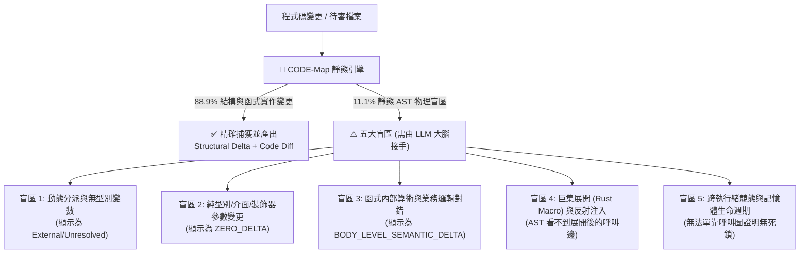

# 🧭 CODE-Map 實戰使用手冊與 AI Agent 協作邊界指南
## 凱撒的歸凱撒，LLM 的歸 LLM：確定性 AST 引擎與神經網路大腦的黃金分工協議

> **手冊定位**：本文件既是給人類開發者的**「CODE-Map 能力邊界說明書」**，也是一份可以直接餵給任何 AI Coding Agent（如 Claude、Gemini、GPT、Local LLM）的**「系統操作手冊 (System Prompt / Operational Manual)」**。  
> **核心哲學**：沒有任何單一工具是萬能的。CODE-Map 負責以 **0.1 秒、100% 確定性**解決前 **88.9%** 的「結構、拓撲、作用域與接線死穴」；而對於靜態語法樹（Tree-sitter AST）天生物理極限無法覆蓋的後 **11.1%** 動態與業務語意，本手冊明確規定了 **LLM 必須如何接手處理的標準作業程序（SOP）**。

---

## 📊 第一章：全景分工矩陣（什麼交給 CODE-Map？什麼交給 LLM？）

在開始寫 Code 或審閱 PR 之前，請先對照此表確認任務屬性：

| 工程任務維度 | 負責主體 | 準確率 / 可靠度 | 為什麼這樣分工？ |
| :--- | :---: | :---: | :--- |
| **1. 定位 UI 控制項 / CLI 入口到後端函式的呼叫鏈** | 🌲 **CODE-Map** | **95%+ (確定性)** | `codemap.py --slice / --bundle` 能毫秒級切出因果子圖，避免 LLM 盲讀千行大檔。 |
| **2. 攔截閉包囚禁 (`BLOCKED_SCOPE`) 與忘記 `export`** | 🌲 **CODE-Map** | **100% (確定性)** | 詞法作用域與模組匯出表是純語法事實，交給 AST 檢查零漏判、零幻覺。 |
| **3. 攔截 HTML 未閉合標籤與 `hidden` 父容器遮蔽** | 🌲 **CODE-Map** | **100% (確定性)** | `html_adapter` 能精確計算 DOM 階層級聯可見性（`BLOCKED_VISIBILITY`）。 |
| **4. 攔截未決阻塞與危險操作 (`panic!`, `todo!`, `sleep`)** | 🌲 **CODE-Map** | **100% (確定性)** | 透過差分不變量（Differential Invariants）精準區分「既有技術債」與「新引入危害」。 |
| **5. 過濾純註釋、排版微調與無效變更 (`ZERO_DELTA`)** | 🌲 **CODE-Map** | **100% (確定性)** | `compute_executable_fingerprint` 自動剝除註釋計算 AST 指紋，防止無效重審。 |
| **6. 驗證上位架構契約 (`SpecVerifier` 偏序與 `await`/守衛)** | 🌲 **CODE-Map** | **98% (確定性)** | 自動驗證是否漏寫 `await`、漏寫 `if (!ok) return` 早退守衛，並識破 Subagent 虛假異議。 |
| **7. 審查函式內部演算法與算術邏輯 (`BODY_LEVEL_SEMANTIC_DELTA`)** | 🧠 **LLM 大腦** | **LLM 強項** | CODE-Map 負責把修改前後的函式抓出來對照，但「`i+1` 還是 `i-1` 才不會越界」必須由 LLM 判斷。 |
| **8. 消解無型別註記的動態多型 (`External/Unresolved`)** | 🧠 **LLM 大腦** | **LLM 強項** | 沒寫 Type Hint 的 `runner.process()`，AST 不知道 `runner` 是誰，但 LLM 看上下文一眼就懂。 |
| **9. 審查純型別定義 (`.d.ts`)、Schema 欄位與巨集展開** | 🧠 **LLM 大腦** | **LLM 強項** | 純型別或 Decorator 參數微調常被 AST 視為 `ZERO_DELTA`，需由 LLM 評估其執行期契約影響。 |

---

## ✅ 第二章：CODE-Map 的五大強項與適用領域（What CODE-Map Masters）

在以下五大場景中，**請 100% 信任並優先調用 CODE-Map**，禁止 LLM 憑感覺肉眼盲猜：

### 2.1 場景一：修改代碼前的「零雜訊因果切片」（Pre-Edit Context Slicing）
* **適用領域**：Web 前端（HTML + JS/TS/React/Vue）、桌面 GUI（C# WPF/Avalonia, Python PyQt/Tkinter）、終端 TUI（Textual, Ratatui, Bubbletea, Spectre.Console）以及 CLI 工具（Cobra, Ripgrep）。
* **解決痛點**：防止 Agent 為了改一個按鈕行為而讀取整支 2,000 行的檔案。
* **標準指令**：
  ```powershell
  # 提取特定控制項錨點的語意控制樹與依賴函式原始碼包
  python.exe -X utf8 codemap.py --file "src/app.js" --slice "#btnSubmit"
  python.exe -X utf8 codemap.py --file "src/app.js" --bundle "#btnSubmit"
  ```

### 2.2 場景二：跨檔案接線與作用域死穴攔截（Scope & Export Guardrails）
* **適用領域**：多模組重構、拆檔、將內部 Helper 抽離為獨立共用模組。
* **解決痛點**：AI Agent 最常犯的低級錯誤——「在 A 檔案呼叫了 B 檔案的函式，卻忘記在 B 檔案加上 `export`」，或是「把事件處理器寫在某個初始化閉包內部，導致外部 DOM 綁定時拋出 `ReferenceError`」。
* **標準指令**：
  ```powershell
  # 跨檔案聯合建圖並檢驗是否有 BLOCKED_SCOPE 或未匯出死穴
  python.exe -X utf8 codemap.py --dir "src/" --check
  ```

### 2.3 場景三：PR / Commit 雙軌語意差分審查（Semantic Git Diff）
* **適用領域**：Code Review、CI/CD 預審、驗證 Subagent 提交的 Patch。
* **解決痛點**：傳統 `git diff` 混雜大量行號位移與排版變更。CODE-Map 會將變更精確切分為三類：
  1. `STRUCTURAL_GRAPH_DELTA`（結構性拓撲變動：新增/拆除了函式節點或呼叫邊、守衛狀態改變）。
  2. `BODY_LEVEL_SEMANTIC_DELTA`（函式體語意變動：呼叫拓撲不變，但函式內部實作或頂層常數 `MODULE_STATE` 改變，自動附上 Before/After 完整函式代碼對照）。
  3. `ZERO_DELTA`（無語意圖譜變動：純註釋、空白排版或純型別宣告）。
* **標準指令**：
  ```powershell
  python.exe -X utf8 codemap.py --file "src/router.py" --git-diff HEAD~1 --check
  ```

### 2.4 場景四：上位規格契約驗收與防唬爛查核（Spec & Objection Verification）
* **適用領域**：Multi-Agent 協作（Architect Agent 派發任務給 Coder Subagent）。
* **解決痛點**：
  - 確保下游 Subagent 嚴格遵守「必須先呼叫 `confirmModal`、必須有 `if (!ok) return` 條件守衛、必須 `await deleteRpc`」的偏序約束。
  - 當 Subagent 抱怨「某檔案不存在某 API」而拒絕實作時，直接用 AST 實地查驗其證據真偽。
* **標準指令**：
  ```powershell
  # 檢驗實作是否符合上位規格契約
  python.exe -X utf8 codemap.py --file "src/ui.js" --verify-spec "spec.json"
  # 查驗 Subagent 提出的規格異議是否說謊
  python.exe -X utf8 codemap.py --verify-objection "objection.yaml" --repo "."
  ```

### 2.5 場景五：HTML DOM 階層與物理可見性檢驗（DOM Visibility Cascade）
* **適用領域**：原生 HTML、樣板引擎與前端浮層/彈窗（Modal / Dropdown / Toast）除錯。
* **解決痛點**：抓出「JS 事件有綁上、函式也有執行，但因為外層 `<div>` 帶有 `hidden` 或 `style="display:none"`，導致彈窗被囚禁在不可見容器內」的視覺死穴（`BLOCKED_VISIBILITY`），以及未閉合標籤（`UNCLOSED_TAG`）。

---

## ⚠️ 第三章：CODE-Map 的五大不足與物理極限（Known Blind Spots）

由於 CODE-Map 選擇了**「零編譯依賴、零 LSP 冷啟動、純 Tree-sitter 語法樹分析」**的輕量級路線，它在設計上存在以下 **5 個明確的盲區**（約佔真實世界開源變更的 **11.1%**）。

**所有使用 CODE-Map 的人類與 LLM 必須清楚認知這些限制，絕不可盲目迷信：**



### 盲區 1：動態語言無型別變數與多型分派（Dynamic Dispatch & Duck Typing）
* **不足說明**：
  CODE-Map 沒有綁定笨重的語言伺服器（LSP / Type Checker）。在 Python、JavaScript 或無明確接收器型別的呼叫中，若寫出 `handler.process(data)`，而 `handler` 是透過參數傳入且未加型別對照，CODE-Map 無法得知 `handler` 執行期是哪個類別的實例，因此會將該呼叫邊標記為 `FUNCTION_DEF:external::handler.process (External/Unresolved)`。

### 盲區 2：型別即邏輯、Schema 定義與裝飾器元數據（Type-Level Logic & Metadata）
* **不足說明**：
  在 TypeScript（`.d.ts` 或複雜泛型 `interface`）、Rust（`trait` 綁定約束）、C#（Attribute 屬性標籤）或 Python（Pydantic `Field(...)` / FastAPI 路由裝飾器參數）中，若一個 Commit **只修改了 `struct`/`interface` 的欄位型別，沒有修改任何 `def`/`fn` 函式體，也沒有修改頂層賦值常數**，CODE-Map 會將其歸類為 `ZERO_DELTA`。

### 盲區 3：函式內部演算法與邊界條件的「語意正確性」（Algorithmic Correctness）
* **不足說明**：
  當你把 `if (index > max_len)` 改成 `if (index >= max_len)`，或者調整了正規表示式 `CAMEL_PROPS` 的匹配字元時，CODE-Map 能 **100% 捕獲**這個函式或常數發生了 `BODY_LEVEL_SEMANTIC_DELTA`，並把 Before/After 原始碼端到你面前。但 **CODE-Map 本身不會幫你算數學**——它不知道 `>` 和 `>=` 哪一個才不會發生 Off-by-one 越界，它只會檢查有沒有引入語法死穴，然後給你 `🟢 READY_TO_SHIP`。

### 盲區 4：編譯期巨集展開與動態反射（Macro Expansion & Reflection）
* **不足說明**：
  - 在 Rust 中（如 `ratatui`、`bevy`、`zellij`），若呼叫邊藏在複雜的聲明式巨集（`macro_rules!`）或過程巨集（Proc-Macro）內部，Tree-sitter 只能看到 `macro_invocation` 節點，看不到巨集展開後生成的底層方法調用。
  - 在 Python/JS 中，透過 `getattr(obj, f"handle_{event}")()` 或 ` Reflect.apply` 動態拼接字串的呼叫，靜態 AST 無法連通目標函式。

### 盲區 5：高併發競態條件與資源生命週期（Concurrency Races & Memory Lifetime）
* **不足說明**：
  CODE-Map 能檢查你有沒有加 `await`（`flow_type="AWAIT"`），也能抓出在主執行緒呼叫 `time.sleep` / `Thread.Sleep` 的同步阻塞危害。但對於「兩個非同步 Worker 是否存在共享狀態 Race Condition」、「分布式鎖是否會 Deadlock」或「KV Cache 區塊是否會 Write-After-Free」，靜態呼叫圖無法給出形式化證明。

---

## 🤖 第四章：給 LLM / AI Agent 的標準處理指令（SOP for LLMs）

> **【致正在閱讀本手冊的 AI Agent】**：  
> 當你在開發或審查任務中使用 CODE-Map 時，**你與 CODE-Map 是互補的搭檔**。請嚴格遵守以下五條 SOP 來處理 CODE-Map 的輸出與盲區：

### 📌 SOP 1：看到 `🟢 READY_TO_SHIP` 時，絕不代表你可以跳過邏輯審查！
* **CODE-Map 說 `🟢 READY_TO_SHIP` 的真正含義**：
  「本檔案沒有閉包作用域死穴（`BLOCKED_SCOPE`）、沒有新引入 `panic`/`todo!`/`sleep` 阻塞危害、沒有違反 DOM 可見性，語法拓撲結構安全。」
* **LLM 必須接手做的動作**：
  1. 立即閱讀報告下方的 `🔍 函式實作語意變更對照包 (Function Implementation Semantic Diff)`。
  2. 逐行比對 `Before Implementation` 與 `After Implementation` 的邏輯差異（特別是條件判斷、`return` 值、邊界索引、型別轉換與異常處理）。
  3. 結合專案測試套件（如執行 `pytest`、`cargo test`、`npm.cmd test`）驗證業務邏輯是否真正正確。

### 📌 SOP 2：遇到 `External/Unresolved` 呼叫邊時的消解步驟
* **當你在 CODE-Map 輸出中看到**：
  `+ [新增呼叫邊] process_request ──[CALLS]──> handler.validate (External/Unresolved)`
* **LLM 必須接手做的動作**：
  1. **判斷是否為標準庫/第三方套件**：若目標是 `json.dumps`、`strings.HasPrefix`、`Math.max` 等語言標準庫，屬於正常外部呼叫，無需深究。
  2. **若目標是專案內部的多型物件方法（如 `handler.validate`）**：
     - 不要盲目全檔讀取！請先查看當前函式簽章（Before/After Signature）中 `handler` 參數的型別註記（Type Annotation）。
     - 若無型別註記，僅針對該方法名在工作區進行精準符號定位（或查看檔案頂部的 `import` 來源），確認被調用的具體類別實作簽章與回傳值是否相容。

### 📌 SOP 3：遇到 `ZERO_DELTA` 時的二次確認原則
* **當 CODE-Map 回報某個變更檔案為 `ZERO_DELTA` 時**：
* **LLM 必須接手做的動作**：
  1. 若你正在做 **Git Commit Review**，且發現該檔案是 `.d.ts`、Pydantic `models.py`、Rust `struct` 定義檔或設定檔，請用 `git diff` 看一眼該檔案的原始文字變更（通常只有幾行）。
  2. 判斷該變更是否為**「純註釋/排版微調」**（若是，直接忽略放行）；若該變更是**「修改了資料結構 Schema 欄位、介面型別約束或 Decorator 參數」**，請用你的語言知識評估該型別變更是否會導致下游呼叫端編譯失敗或執行期行為改變。

### 📌 SOP 4：處理動態反射（`getattr`）與框架依賴注入（DI）
* **當專案使用動態路由、反射分發或 IoC 容器（如 FastAPI `Depends`、NestJS `@Injectable`、Vue Reactivity）時**：
* **LLM 必須接手做的動作**：
  - 理解靜態 AST 看不到框架背後的隱式調用鏈（Implicit Call Edges）。
  - 在撰寫或修改被動態反射呼叫的函式（例如 `def on_event_xxx(self)`）時，即使 CODE-Map 顯示其入度為 0，LLM 也應根據框架慣例（Naming Convention / Decorator）保留其介面簽章，不得誤判為無用死碼而將其刪除。

### 📌 SOP 5：嚴格遵守「微創打補丁」與「確定性終止」（Anti-Thrashing）
* **無論在任何情況下，LLM 必須遵守的操作紀律**：
  1. **用 CODE-Map 定位，用 `edit_file` 微創手術**：一旦透過 CODE-Map 鎖定目標函式與行號區間（如 `L213~L253`），只讀取並替換該函式區塊，**嚴禁全量重寫整支檔案**。
  2. **一次驗證通過即收工**：修改完畢後，跑一次 `codemap.py --check`（確認無拓撲與作用域破壞）加上一次單元測試。只要雙雙 PASS，**立即終止回合向使用者回報結果**，嚴禁陷入「不放心又重讀全檔」的顛簸迴圈。

---

## 🛠️ 第五章：常見問題快速排查表（Troubleshooting Cheat Sheet）

| 現象 / 狀態碼 | 原因解析 | LLM / 開發者標準應對動作 |
| :--- | :--- | :--- |
| **`🔴 BLOCKED_BY_INVARIANTS`**<br>(`BLOCKED_SCOPE`) | 呼叫端嘗試調用一個被深鎖在內部閉包、或跨檔案未加 `export` 的私有函式。 | **真 Bug！** 將目標函式提升至模組頂層作用域，或在定義處補上 `export` / `pub` / `public`。 |
| **`🔴 BLOCKED_BY_INVARIANTS`**<br>(`BLOCKED_VISIBILITY`) | HTML 中的互動控制項或彈窗所在的父容器帶有 `hidden` 或 `display:none`。 | **真 Bug！** 將浮層（Modal/Toast）移出隱藏父容器，掛載於 `<body>` 頂層或修正 CSS 顯示狀態。 |
| **`🔴 BLOCKED_BY_INVARIANTS`**<br>(`New Hazards`) | 本次修改**新引入**了 `panic()`、`todo!()`、`time.sleep()`、`window.confirm` 等危害。 | 檢查是否為忘記移除的佔位符（如 `todo!()`）或在 UI/非同步主執行緒誤用了同步休眠，改用非同步替代方案。 |
| **`ℹ️ 存量環境提醒`**<br>(`🟢 READY_TO_SHIP`) | 檔案內原本就有舊的 `panic()` 或阻塞呼叫，但**不是本次 Commit 新引入的**。 | **正常放行！** 差分不變量引擎已自動過濾歷史技術債，無需為舊債阻斷當前修復。 |
| **`🔴 SPEC_VIOLATION`**<br>(`MISSING_AWAIT` / `MISSING_GUARD`) | 實作代碼違反了 `spec.json` 規定的非同步等待或 `if (!ok) return` 條件守衛。 | 依照反例報告指出的具體呼叫邊，補上 `await` 關鍵字或前置早退守衛（Early-Return Guard）。 |
| **`🚨 EVIDENCE_FALSIFIED`** | Subagent 提出的 `Spec Objection` 宣稱某檔案無某函式，但被 AST 當場抓包該函式存在。 | 駁回 Subagent 的藉口，強制要求其引入該檔案已存在的公開函式完成實作。 |
