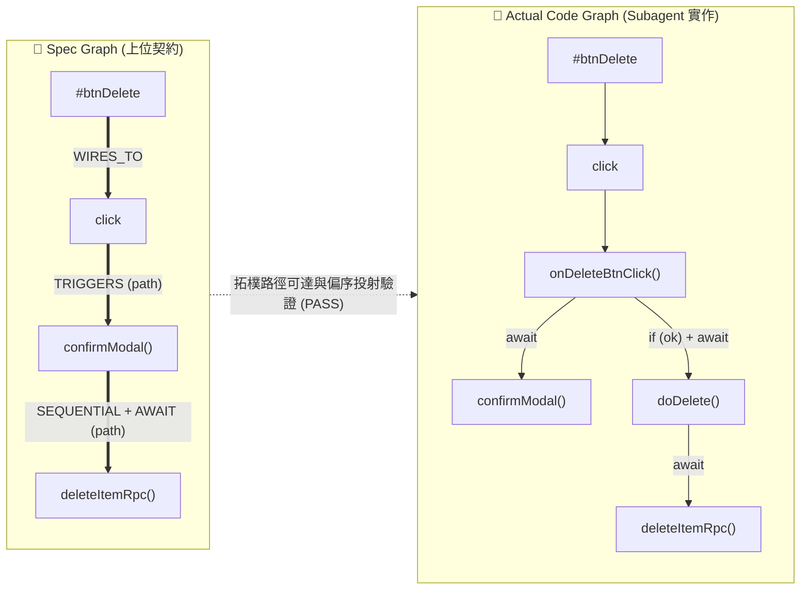
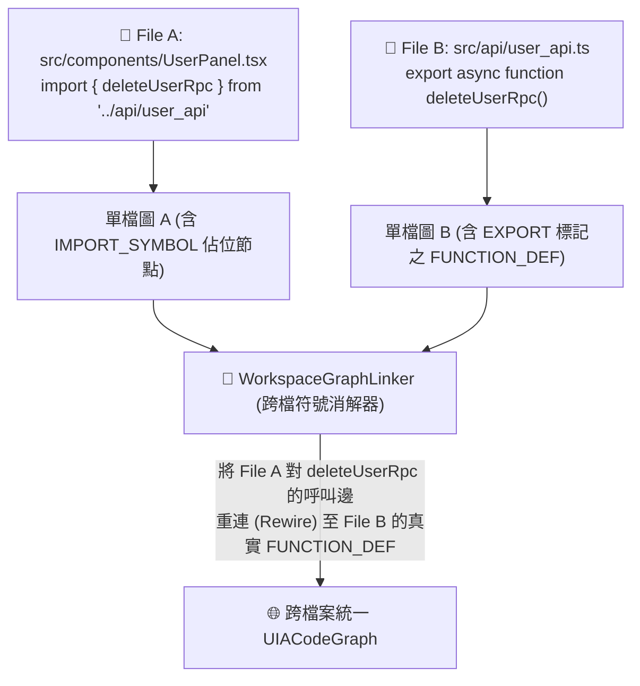

# 🛠️ CODE-Map 架構升級與底層修正工程清單 (Engineering TODO List)

> **文檔目標**：供另一台 Antigravity Agent 直接讀取並無縫執行架構升級。  
> **核心背景**：經過 Gemini 3.8 初版實作、Opus 5.5 補充 `Spec Objection` 流程，以及第三輪深度源碼審計後，確認現有 CODE-Map 在「單檔語意 Diff」表現優異，但若要真正落地為 **Multi-Agent 反向規格驗收裁判 (Spec-Driven Verifier)**，必須解決以下 **3 大核心工程斷層** 與 **2 項防禦性補正**。

---

## 📋 任務總覽與執行優先級 (Execution Checklist)

- [ ] **Task 1 (P0 - 補齊真裁判)**：新增 `uia_coder/core/spec_verifier.py`，實作基於「有向路徑可達性與拓樸偏序 (Path Reachability & Topological Partial Order)」的 `SpecVerifier`，並掛載至 `cli.py --verify-spec`。
- [ ] **Task 2 (P0 - 修補底層 Bug 與強化 AST 邊語意)**：
  - [ ] **2A**：修正 `uia_coder/core/differ.py` 中 `get_canonical_id()` 同名函式碰撞覆蓋 Bug，改用包含詞法作用域鏈的 **Qualified Lexical Path**。
  - [ ] **2B**：在 6 大語言適配器與 `graph.py` 的呼叫邊（`CALLS` / `RESOLVES_TO`）中，新增 AST **條件守衛 (`is_conditional` / `guard_expr`)** 與 **異常處理 (`is_error_handled`)** 屬性標註。
- [ ] **Task 3 (P1 - 打通跨檔接線)**：新增 `uia_coder/core/workspace_graph.py`，支援跨檔案 `import` / `export` 符號消解與多檔圖譜拼接 (`build_project_graph`)，解決 Subagent A (API) 與 Subagent B (UI) 跨檔斷電問題。
- [ ] **Task 4 (P2 - 防禦性補正)**：
  - [ ] **4A**：在 `SpecVerifier` 中實作 `verify_objection_evidence()`，用 AST 實地查核 Subagent 提出的 `Spec Objection`，防止幻覺偷懶。
  - [ ] **4B**：修正 `tools/audit_*.py` 基準測試指標，將「結構性因果圖變動 (`Structural Graph Delta`)」與「純函式內文字變動 (`Function Body Text Delta`)」分開統計，消除白皮書數據水分。

---

## 🥇 Task 1：實作路徑偏序規格驗收器 (`SpecVerifier`)

### 1. 為什麼要改？ (Why / Root Cause)
* **現狀問題**：目前 `uia_coder/core/differ.py` 的 `UIAGraphDiffer.diff_graphs(g_before, g_after)` 採用的是 **精確邊對邊比對 (Exact Edge-to-Edge Matching)**：
  ```python
  edges_added = [k for k in edges_canon_a if k not in edges_canon_b]
  edges_removed = [k for k in edges_canon_b if k not in edges_canon_a]
  ```
* **致命後果**：當上位 Architect Agent 定義規格圖譜 `Spec Graph` 時，通常只指定關鍵業務節點，例如：
  `#btnDelete ➔ click ➔ confirmModal ➔ deleteItemRpc`
  但 Subagent 在實作時，為了遵循 Clean Code，極可能抽取私有輔助函式（Helper Functions）：
  `#btnDelete ➔ click ➔ handleDeleteClick ➔ validateSelection ➔ confirmModal ➔ executeDelete ➔ deleteItemRpc`
  若直接拿 `UIAGraphDiffer` 比對 `Spec` 與 `Actual`，會因為中間多出 `handleDeleteClick` 等中繼節點，導致規格要求的直接邊 `(confirmModal -> deleteItemRpc)` 被判定為 **「已拆除 (Removed Edge)」**，將完全合法且優質的實作誤判為違規退件！

### 2. 要怎麼改？ (How / Implementation Spec)



1. **新增檔案**：`d:\AntiGravity\UIA_Coder\uia_coder\core\spec_verifier.py`
2. **核心資料結構 (`SpecContract`)**：
   支援從 JSON / YAML 或 `UIACodeGraph` 載入規格，包含：
   * `required_anchors`: 必須存在的 UI/CLI 控制項錨點（例如 `#btnDelete`）。
   * `required_causal_chains`: 有序因果鏈要求（例如 `["#btnDelete", "confirmModal", "deleteItemRpc"]`），以及每個階段的約束（如 `require_await: True`, `require_conditional_guard: True`）。
   * `invariants`: 全域守衛要求（預設 `no_scope_trap: True`, `no_blocking_api: True`）。
3. **核心演算法 (`SpecVerifier.verify(spec_graph, actual_graph)`)**：
   * **Step 1 (全域不變量守衛)**：先呼叫 `actual_graph.check_invariants()`，若有 `BLOCKED_SCOPE` 或 `BLOCKED_INVARIANT` 直接攔截。
   * **Step 2 (錨點存在性檢查)**：確認 `Spec` 中所有 `UI_CONTROL` 節點在 `Actual` 中皆有對應的 Canonical / Label 節點。
   * **Step 3 (有向路徑可達性 Path Reachability)**：
     對於 `Spec` 中的每一條關鍵因果邊 $(u_{spec} \to v_{spec})$：
     - 若 $u_{spec}$ 與 $v_{spec}$ 是**控制項到目標函式**或**父函式到子函式**，使用 `nx.has_path(actual_graph.g, u_actual, v_actual)` 檢查是否存在有向路徑（允許中間經過任意數量的 Helper 函式）。
     - 若兩者都是由同一個父處理常式依序呼叫的兄弟階段（例如 `handleDelete` 內先呼叫 `confirmModal` Stage 1，再呼叫 `deleteItemRpc` Stage 2），則找到兩者在 `Actual` 中的最近共同祖先函式節點（Lowest Common Ancestor Function $LCA$），檢查從 $LCA$ 出發到達 $u_{actual}$ 的入口邊 `sequence_order` 是否嚴格小於到達 $v_{actual}$ 的入口邊 `sequence_order`（$\text{order}(u) < \text{order}(v)$）。
   * **Step 4 (非同步時序傳遞驗證)**：
     若 `Spec` 要求某階段必須為 `flow_type == "AWAIT"`，則檢查 `Actual` 中從父處理常式到目標節點的呼叫路徑上，至少有一條關鍵呼叫邊帶有 `flow_type == "AWAIT"`。
   * **Step 5 (輸出 Proof-Carrying 違規報告)**：
     若驗證失敗，回傳結構化 JSON 與 Markdown 報告，精確列出：哪一條規格契約邊斷裂、目前 `Actual Graph` 在該錨點下的實際展開樹為何、建議修復位置（行號）。
4. **CLI 整合 (`uia_coder/cli.py`)**：
   * 新增參數：`--verify-spec <SPEC_FILE>`（可搭配 `--file <CODE_FILE>` 或多檔案）。

---

## 🥈 Task 2：修正 `differ.py` 同名函式碰撞 Bug 與強化 AST 條件/異常邊語意

### 子任務 2A：修正 `get_canonical_id` 同名碰撞覆蓋問題

#### 1. 為什麼要改？ (Why / Root Cause)
* **問題定位**：[`uia_coder/core/differ.py`](file:///d:/AntiGravity/UIA_Coder/uia_coder/core/differ.py#L13-L17) 第 13~17 行與第 266~267 行：
  ```python
  def get_canonical_id(node_data: Dict[str, Any], fallback_id: str) -> str:
      cat = node_data.get("category", "")
      label = node_data.get("label", fallback_id)
      return f"{cat}:{label}"
  ...
  rev_canon_b = {v: k for k, v in canon_b.items()}
  rev_canon_a = {v: k for k, v in canon_a.items()}
  ```
* **致命後果**：當同一個檔案內有兩個不同元件、類別或閉包定義了同名函式（例如兩個 React Component 內部都有 `const handleClick = () => {}`，或兩個 Closure 內都有 `function init()`），它們的 `canonical_id` 都會變成 `FUNCTION_DEF:handleClick`。
  在建立 `rev_canon_b` 與 `edges_canon_b` 字典時，**後出現的節點會無聲無息地覆蓋掉先出現的節點**，導致圖差分漏掉前一個函式的所有變更與接線！

#### 2. 要怎麼改？ (How / Implementation Spec)
1. **修改 `uia_coder/core/differ.py` 的 `get_canonical_id()`**：
   * 從 `node_data.get("scope", {})` 中提取 `scope_id`。
   * 將 `scope_id` 中包含行號與檔名的後綴剝除，還原出**詞法作用域階層路徑 (Lexical Scope Chain)**。
     例如：`scope:UserModal@app.tsx:L10` 內部的 `handleClick`，其 Qualified ID 應為：
     `FUNCTION_DEF:UserModal::handleClick`（若在全域則為 `FUNCTION_DEF:global::handleClick`）。
   * 更好且一勞永逸的做法：在各語言 Adapter 建立 `scopes[new_scope_id]` 時，直接維護一個 `"qualified_path": "UserModal.init"` 字串並寫入節點的 `scope["qualified_path"]`，讓 `get_canonical_id()` 直接讀取 `f"{cat}:{qualified_path}::{label}"`。
   * 若在同一作用域內仍有極少數同名重載（如 TypeScript overload 或重複綁定），在建立 `rev_canon` 時檢測碰撞並附加序號 `#1`, `#2`，絕不允許字典靜默覆寫。

---

### 子任務 2B：在 AST 呼叫邊加入「條件分支守衛 (`is_conditional`)」與「錯誤捕捉 (`is_error_handled`)」

#### 1. 為什麼要改？ (Why / Root Cause)
* **現狀問題**：目前的圖譜只知道「函式 A 先呼叫了 `confirmModal()`，後呼叫了 `deleteItemRpc()`」，卻不知道 **`deleteItemRpc()` 是否受到 `if (confirmed)` 的條件保護**！
  如果 Subagent 寫出以下致命 Bug：
  ```javascript
  async function onDelete() {
      const ok = await confirmModal("確定刪除？");
      // Bug: 忘了寫 if (!ok) return; 直接往下刪！
      await deleteItemRpc(id);
  }
  ```
  現有的 CODE-Map 會給出 `🟢 READY_TO_SHIP`，因為 `confirmModal` 和 `deleteItemRpc` 都通電且都有 `await`！

#### 2. 要怎麼改？ (How / Implementation Spec)
1. **在 `BaseUIAGraphBuilder` (`uia_coder/core/base_adapter.py`) 新增共用 AST 祖先檢查輔助方法**：
   ```python
   def _inspect_control_context(self, call_node, enclosing_func_node) -> Dict[str, Any]:
       """
       從 call_node 向上走訪 parent 直到 enclosing_func_node，
       檢查該呼叫點是否位於條件分支 (if / switch / match / 三元運算) 或異常處理 (try / catch) 內部，
       或是該函式在此呼叫點之前是否已有 early-return 守衛 (if (...) return)。
       """
   ```
   * **判定條件保護 (`is_conditional: bool`)**：
     1. **直接包裹**：`call_node` 的祖先節點（在函式邊界內）包含 `if_statement`、`switch_statement`、`match_expression`、`conditional_expression`（三元運算子）或邏輯短路 `binary_expression` (`&&` / `||`)。
     2. **Early-Return 守衛（極重要）**：在同一個 `block` 內，排在 `call_node` 之前的兄弟語句（preceding siblings）中，存在包含 `return_statement` 或 `throw_statement` 的 `if_statement`（例如 `if (!ok) return;`）。
   * **判定異常保護 (`is_error_handled: bool`)**：
     `call_node` 的祖先節點包含 `try_statement`（Python/JS/TS/C#）、`.catch()` 鏈式呼叫、Rust 的 `?` (`try_expression`) / `match`，或 Go 緊隨其後的 `if err != nil`。
2. **擴充 `UIACodeGraph.add_edge_rich()` (`uia_coder/core/graph.py`)**：
   * 在邊的屬性中支援 `is_conditional: bool = False`、`guard_type: str = "NONE"`（可為 `"IF_BRANCH"`, `"EARLY_RETURN_GUARD"`, `"SHORT_CIRCUIT"`）與 `is_error_handled: bool = False`。
   * 在 `to_uia_markdown()` 輸出時，若帶有條件守衛，顯示 `🛡️ [guarded]` 標記（例如 `🔒 ⏳ [await] 🛡️ [guarded] [Stage 2] deleteItemRpc()`），讓架構師與 `SpecVerifier` 一眼看穿有沒有漏寫 `if (!ok) return`。

---

## 🥉 Task 3：打通跨檔案符號消解與多檔圖譜拼接 (`WorkspaceGraphBuilder`)

### 1. 為什麼要改？ (Why / Root Cause)
* **現狀問題**：目前所有 Adapter 的 `parse_and_build(source_code, file_path)` 都是**單檔封閉解析**。
* **致命後果**：在真實專案與 Multi-Agent 協同中：
  * **Subagent A** 負責寫 `src/api/user_api.ts`：`export async function deleteUserRpc(id: string) { ... }`
  * **Subagent B** 負責寫 `src/components/UserPanel.tsx`：`import { deleteUserRpc } from '../api/user_api';` 並在 `<button onClick={handleDelete}>` 中呼叫 `deleteUserRpc(userId)`。
  * 在現有單檔架構下，分析 `UserPanel.tsx` 時，`deleteUserRpc` 在本檔找不到 `FUNCTION_DEF`，因此無法得知 `deleteUserRpc` 內部是否有阻塞危害（如 `window.confirm`）、是否為 `async` 函式，也無法透過 `to_causal_code_bundle("#btnDelete")` 把 `user_api.ts` 裡的實作碼一起打包出來！

### 2. 要怎麼改？ (How / Implementation Spec)



1. **在各語言 Adapter 中收集 `imports` 與 `exports` 元資料**：
   * 在 `UIACodeGraph.g.graph`（圖級別 metadata 字典）中新增：
     * `exports`: `Dict[exported_name, func_node_id]`（記錄本檔匯出的函式/方法節點 ID）。
     * `imports`: `List[Dict]`（記錄 `{local_name, imported_name, module_specifier, line}`，例如從 `'../api/user_api'` 匯入 `deleteUserRpc`）。
   * 優先實作 **TypeScript / JavaScript** (`import_statement`, `export_statement`) 與 **Python** (`import_from_statement`, `import_statement`)，再擴及 Go / Rust / C#。
2. **新增檔案 `uia_coder/core/workspace_graph.py` (`WorkspaceGraphBuilder`)**：
   * 提供 `build_from_files(file_paths: List[str], root_dir: str) -> UIACodeGraph` 方法。
   * **Pass 1**：分別呼叫對應語言的 Adapter 產出各檔案的單檔 `UIACodeGraph`，並合併所有節點與邊至一張總圖 `merged_graph`。
   * **Pass 2 (Cross-File Symbol Linking)**：
     遍歷各檔案的 `imports` 表，解析相對路徑或模組路徑找到目標檔案，將呼叫端原本指向未解析外部呼叫點（或 `EXTERNAL_CALL`）的邊，以 `RESOLVES_TO` 連接到目標檔案中真實匯出的 `func_node_id`，同時檢查目標函式是否真的是 `export`（若目標函式忘了寫 `export`，則標記邊狀態為 `BLOCKED_SCOPE`，detail 為 `"跨模組作用域阻隔：目標函式未匯出 (Not Exported)"`！）。
3. **CLI 擴充 (`uia_coder/cli.py`)**：
   * 新增 `--files <FILE1> <FILE2> ...` 或 `--dir <DIR_PATH>` 參數，支援多檔案聯合建圖與跨檔 `--slice`、`--bundle`、`--verify-spec`。

---

## 🛡️ Task 4：防禦性補正（異議防偽查核 + 基準測試指標分離）

### 子任務 4A：Subagent 規格異議 (`Spec Objection`) 的 AST 自動防偽查核
* **背景**：README 第 125~140 行定義了 Subagent 可提交 YAML 格式的 `Spec Objection`（例如宣稱 `evidence: "api/items.ts:L42 只提供 deleteMany(ids)"`）。
* **實作位置**：在 `uia_coder/core/spec_verifier.py` 新增 `verify_objection(objection_dict: Dict, workspace_root: str) -> Dict`。
* **邏輯**：
  1. 解析 `objection["evidence"]` 中提及的檔案路徑與行號。
  2. 直接用 `get_adapter_for_file()` 解析該證據檔案，列出該檔案實際存在的 `FUNCTION_DEF` 清單。
  3. 附加在裁決報告中呈現給上位 Architect Agent（例如：`[AST 自動查證結果]: api/items.ts 確實不存在 deleteItem，在 L38~L55 發現 deleteMany(ids)`），徹底杜絕 Subagent 因偷懶而編造假證據欺騙上位 Agent。

### 子任務 4B：基準測試腳本 (`tools/audit_*.py`) 指標去水分
* **問題定位**：目前 `tools/audit_*.py` 中將 `modified_funcs > 0`（僅函式內文字有變動，但節點、邊、狀態皆無變動）一併計入 `is_captured`，導致無法區分「真正動到控制流/呼叫圖結構的變更」與「單純改動函式內部一行運算式的變更」。
* **修改方式**：
  在統計輸出中拆分為兩個明確指標：
  1. **`Structural Graph Capture`（結構性因果變動）**：`added_edges > 0 or removed_edges > 0 or added_nodes > 0 or removed_nodes > 0 or transitions > 0`。
  2. **`Body-Level Semantic Capture`（函式體實作變動）**：僅 `modified_funcs > 0`。
  兩者相加為總體可執行變更捕獲率，讓報告兼具誠實度與學術嚴謹性。

---

## ✅ 最終驗收標準 (Definition of Done / Verification Commands)

另一台 Antigravity 完成上述修改後，必須確保以下測試全部通過（0 Error）：

1. **既有回歸測試 100% 綠燈**：
   ```powershell
   python.exe -X utf8 tests/test_graph_engine.py
   ```
2. **新增單元測試 `tests/test_next_phase_features.py`**，必須涵蓋並通過以下 4 個測試案例：
   * **Test A (同名函式不碰撞)**：同一檔案內兩個不同類別/閉包各自定義 `onClick()`，修改其中一個，驗證 `UIAGraphDiffer.diff_graphs` 能精準識別被修改的那一個，且不會覆蓋另一個。
   * **Test B (條件守衛與 Early-Return 識別)**：比對「有寫 `if (!confirmed) return;` 再呼叫 `deleteRpc()`」與「沒寫 `if` 直接呼叫 `deleteRpc()`」，驗證前者的呼叫邊帶有 `is_conditional=True` (`guard_type="EARLY_RETURN_GUARD"`)，後者為 `False`。
   * **Test C (`SpecVerifier` 容許 Helper 抽取)**：給定規格 `#btnDelete -> confirmModal -> deleteRpc`，實作代碼中間插入 `handleDelete()` 與 `validate()` 輔助函式，驗證 `SpecVerifier.verify()` 判定為 `🟢 PASS`；若拔掉 `deleteRpc` 的 `await` 或漏掉條件守衛，判定為 `🔴 FAIL`。
   * **Test D (跨檔案 Import 接線與未 Export 攔截)**：`ui.tsx` 匯入 `api.ts` 的 `deleteItem()`，驗證 `WorkspaceGraphBuilder` 能跨檔連通前向切片；若將 `api.ts` 的 `export` 關鍵字拿掉，驗證引擎能抓出 `BLOCKED_SCOPE (Not Exported)`。
