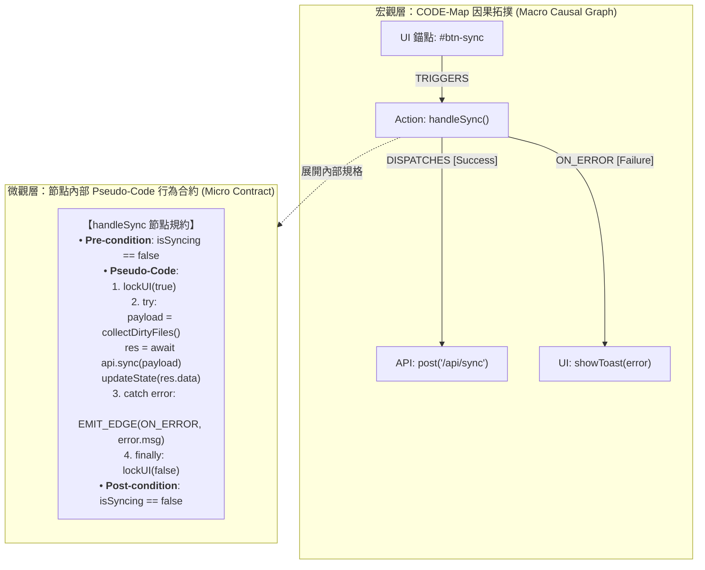

# 📐 CODE-Map 形式化規格規劃與 Subagent 派發指引
## 雙層規約架構：宏觀因果拓撲 (Macro Topology) + 微觀虛擬碼合約 (Micro Pseudo-Code)

> **核心定位**：本指引規範上位架構 Agent (Architect / Planner) 如何使用 **CODE-Map** 進行前置架構設計，並透過在節點中內嵌 **結構化虛擬碼 (Algorithmic Pseudo-Code)** 派發給下位執行 Subagents，徹底解決「寫了功能卻未被觸發」、「函式缺少異常兜底」與「前後端介面斷頭」三大頑疾。

---

## 1. 為什麼需要雙層規約？(The Problem)

在多 Agent (Multi-Agent) 協同軟體開發中，常見兩種極端失敗模式：

| 規格模式 | 運作方式 | 致命缺陷 |
| :--- | :--- | :--- |
| **純自然語言 Prompt** | 「請幫我實作資料同步功能，包含前端按鈕和後端 API」 | 邊界模糊、幻覺嚴重。Subagent 自由發揮函式名稱與狀態，前後端各寫各的，合併時流程無法串接。 |
| **純宏觀拓撲圖** | 定義 `Button(#btn-sync) ➔ handleSync() ➔ post('/api/sync')` | 知道「誰連到誰」，但**不知道函式內部演算法與狀態變化**。Subagent 常寫出空殼函式，或遺漏 `catch`/`finally` 的副作用。 |
| **雙層規約 (CODE-Map)** | **宏觀拓撲（因果連線） + 微觀合約（節點內嵌 Pseudo-Code）** | **時空合一**。宏觀圖保證流程必定通電（可達性證明），微觀虛擬碼約束內部邏輯骨架與分支映射。 |



---

## 2. 節點 Pseudo-Code 資料結構規範 (Node Spec Schema)

在規劃階段產出的 `TargetGraph.json` 或規格定義中，針對 `ACTION`、`HANDLER`、`ROUTER` 等流程節點，必須擴充 `spec` 欄位：

```json
{
  "id": "action_handle_sync",
  "name": "handleSync",
  "category": "ACTION",
  "file": "src/controllers/sync.js",
  "spec": {
    "summary": "非同步檔案同步控制器，負責鎖定 UI、打包變更、發送 API 與異常回滾",
    "inputs": [
      { "name": "event", "type": "ClickEvent" },
      { "name": "activeWorkspace", "type": "string" }
    ],
    "outputs": [
      { "type": "Promise<SyncResult>" }
    ],
    "pre_conditions": [
      "activeWorkspace !== null && activeWorkspace !== ''",
      "!state.isSyncing"
    ],
    "post_conditions": [
      "state.isSyncing === false",
      "state.lastSyncTimestamp > 0"
    ],
    "pseudo_code": [
      "IF state.isSyncing THEN RETURN EARLY",
      "SET state.isSyncing = TRUE",
      "CALL showLoadingIndicator(true)",
      "TRY:",
      "  payload = CALL collectDirtyFiles(activeWorkspace)",
      "  res = AWAIT postJson('/api/sync', payload)",
      "  IF res.status === 200 THEN:",
      "    CALL updateLocalCache(res.data)",
      "    EMIT_EDGE: DISPATCHES -> refreshFileTree()",
      "  ELSE:",
      "    THROW Error(res.errorMessage)",
      "CATCH error:",
      "  EMIT_EDGE: TRIGGERS -> showToast(error.message, 'error')",
      "  CALL logSyncFailure(error)",
      "FINALLY:",
      "  SET state.isSyncing = FALSE",
      "  CALL showLoadingIndicator(false)"
    ],
    "branch_to_edge_mapping": {
      "on_success": "refreshFileTree",
      "on_failure": "showToast",
      "on_finally": "showLoadingIndicator"
    }
  }
}
```

---

## 3. Pseudo-Code 撰寫四大黃金法則

1. **關注狀態轉移與因果分支，嚴禁撰寫語言特定語法糖**：
   - ❌ 錯誤：寫出具體框架語法（如 `useCallback((e) => setVal(e.target.value), [deps])`）。這會扼殺 Subagent 的語言適配彈性。
   - ✅ 正確：寫出邏輯骨架 `IF state.dirty THEN CALL commitChanges()`。
2. **分支到邊的嚴格映射 (Branch-to-Edge Mapping)**：
   - Pseudo-Code 中每一個關鍵的邏輯分支（`IF` / `ELSE` / `CATCH`），都必須標註 `EMIT_EDGE: <EdgeType> -> <TargetNode>`。
   - 確保「所有分支都有因果歸宿」，徹底消滅吞掉 Error 的空 Catch 區塊。
3. **強制宣告前後置不變量 (Pre/Post-Conditions)**：
   - 明確指出執行該節點前系統必須處於什麼狀態（例如使用者已登入、Token 未過期）。
   - 明確指出執行完畢後必須達成的狀態保證（例如 Lock 必須釋放、計數器 +1）。
4. **控制項錨定 (Anchor Grounding)**：
   - 入口 Pseudo-Code 必須明確關聯觸發源（例如：由 DOM `#btn-submit` 觸發，或由 CLI 參數 `--force` 觸發）。

---

## 4. 上位 Agent 派發給 Subagent 的合約模板

上位架構 Agent (Parent) 在透過 `invoke_subagent` 或訊息派發任務時，必須以此結構作為 Task Prompt：

````markdown
### 🎯 任務指派：節點實作合約 (Node Implementation Contract)

- **目標節點 ID**：`action_handle_sync`
- **目標原始碼檔案**：`src/controllers/sync.js`
- **所屬控制項錨點**：`index.html` 中的 `<button id="btn-sync">`

#### 1. 宏觀拓撲約束 (Topological Invariants)
- **入邊 (Incoming Edges)**：必須被 `#btn-sync` 的 `click` 事件監聽器接通。
- **出邊 (Outgoing Edges)**：
  - 成功分支必須呼叫 `refreshFileTree()`。
  - 失敗分支必須呼叫 `showToast(msg, 'error')`。
- **違規禁令**：不得將此函式宣告在未導出的內部閉包中（禁止 `BLOCKED_SCOPE`）。

#### 2. 微觀演算法骨架 (Algorithmic Pseudo-Code)
```python
IF state.isSyncing:
    RETURN
state.isSyncing = True
showLoading(True)
TRY:
    payload = collectDirtyFiles(workspace)
    res = AWAIT postJson('/api/sync', payload)
    updateLocalCache(res.data)
    CALL refreshFileTree()
CATCH err:
    CALL showToast(err.message, 'error')
FINALLY:
    state.isSyncing = False
    showLoading(False)
```

#### 3. 驗收標準 (Acceptance Criteria)
本任務完成後，CODE-Map 將自動執行靜態圖譜比對：
1. 驗證 `TargetGraph` 中的 3 條因果邊是否 100% 存在於實際 AST 中。
2. 驗證是否實作 `try / catch / finally` 結構與邊界副作用。
3. 任何懸空引用或未接通邊將被直接退件重修。
````

---

## 5. CODE-Map 骨架驗收檢查 (Skeleton Verification)

CODE-Map 的語言適配器（`python_adapter`、`javascript_adapter`、`html_adapter` 等）在編譯 Actual Graph 時，會自動進行兩階段審查：

1. **圖論級驗收（Graph-Level Invariants）**：
   - `NO_UNTRIGGERED_ACTION`：`handle_sync` 是否有從 UI 到達的路徑？（入度 > 0）
   - `NO_DANGLING_GROUNDING`：呼叫的 `refreshFileTree` 與 `showToast` 是否真實存在？
2. **骨架級驗收（Skeleton AST Invariants）**：
   - 檢查該函式 AST 語法樹是否具備 `TryStatement` 節點。
   - 檢查 `CatchClause` 內部是否存在對 `showToast` 節點的呼叫語句。
   - 檢查 `FinallyClause` 內部是否存在對狀態變數的重置語句。

若 Subagent 漏寫任何一項，CODE-Map 差分驗證器 (`UIAGraphDiffer`) 會直接產出結構化反例，促使 Subagent 精準修復，達成全自動的形式化工程閉環。
