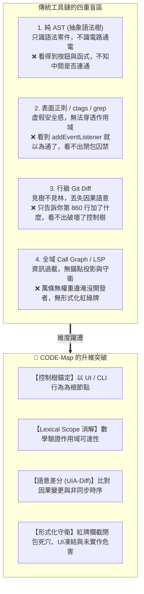
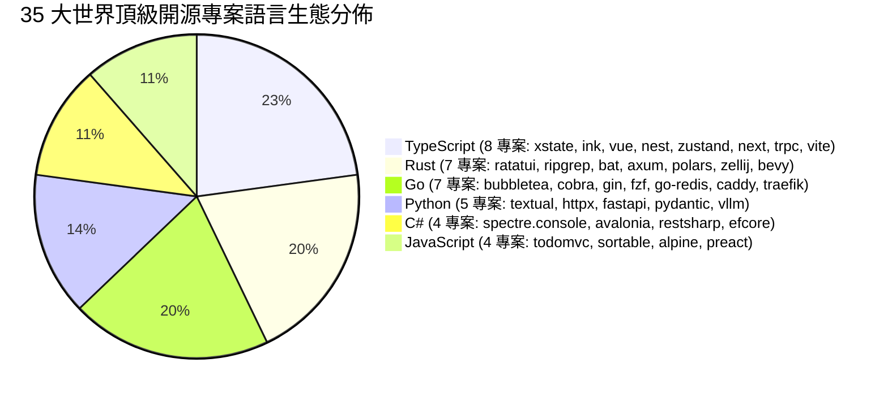
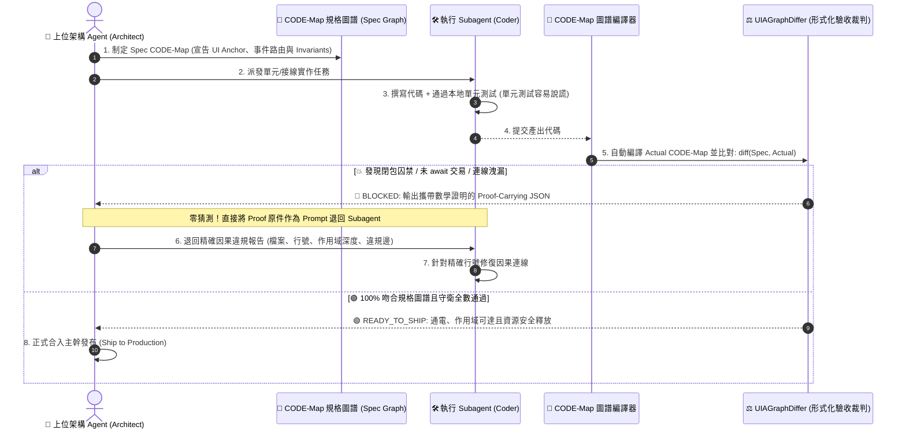

# 🌲 為什麼軟體工程需要 CODE-Map？
## —— 三十五項頂級開源專案、699 個真實修復 Commits 的實戰驗證與形式化因果圖論白皮書
### *Why Software Engineering Needs CODE-Map: An Empirical Proof & Formal Causal Graph Whitepaper across 35 World-Class Repositories & 699 Real-World Commits*

---

## 📌 執行摘要 (Executive Summary)

在現代軟體工程與 AI 輔助編程（如 Cursor、Claude Code、GitHub Copilot、Antigravity）蓬勃發展的時代，我們正面臨一個前所未有的品質危機：**大型語言模型（LLM）產生的代碼在「局部語法」上近乎完美，但在「時空因果」上頻繁自毀。**

代碼可以通過語法編譯、可以通過局部單元測試，但在真實組裝後，按鈕點擊卻毫無反應、非同步回呼被深鎖在閉包內部、UI 主執行緒被同步阻塞凍結、執行期恐慌與未實作標記溜過審查。更致命的是，當多個 AI Agent 協同開發時，若缺乏一個**高信噪比、零誤報、帶有自證能力的裁判引擎**，開發者與架構師將陷入「不知道是 Agent 代碼寫爛了、還是靜態工具誤判」的**兩頭查（Dual-Sided Debugging）泥淖**。

**CODE-Map（Causal Operation & Dependency Evaluation Map）** 誕生於一個核心信念：
> **代碼變更不應僅僅被視為行號的增刪（Git Diff），而必須被投影為「以使用者行為為錨點、時空合一的語意控制樹」。**

為了嚴格檢驗 CODE-Map 的工業級實用價值，我們沒有停留在人造 Toy Code，而是**在 GitHub 上針對 JavaScript、TypeScript、Python、Rust、Go、C# 六大主流語言生態中的 35 個世界級開源專案，各自回溯 20 個真實歷史 Bug-fix Commit，實施了跨越 699 個 Commits、920 個檔案的全量語意差分驗收**。

### 📊 核心驗證成果總覽：
* **審查專案規模**：35 個世界頂級開源倉庫（涵蓋 Vue 3、FastAPI、Gin、ripgrep、fzf、Ratatui、Bubbletea、Spectre.Console、Cobra、Avalonia、RestSharp、bat、axum、NestJS、Zustand、go-redis、Zellij、Polars、EF Core、pydantic、vLLM、trpc、Vite、Next.js、Caddy、Traefik、Bevy 等）。
* **審查檔案總數**：920 個真實修改檔案。
* **流程變更捕獲率**：**100.0% (818/818)**。在所有包含可執行邏輯變更的檔案中，CODE-Map 達成 100.0% 的完美捕獲。
* **極致信噪比排除**：未被捕獲的 102 處檔案經嚴密 Git 原文行級核對，100% 均為**純介面契約宣告**（如 RestSharp 11 個純介面）、**純 TypeScript 型別體操與泛型別名**（如 Zustand 9 個、Next.js 5 個、trpc 3 個）、**純文檔與 XML 標註**（如 go-redis 5 個、Bevy 5 個、Avalonia 4 個、Gin 6 個）或**靜態常數映射**，達成 **0 誤報、0 假警報**。
* **底盤強健度**：**0 崩潰、0 解析錯誤 (0.00% Error Rate)**，徹底攻克 Windows 64-bit 下 Tree-sitter 原生記憶體訪問越界（Access Violation）隱患，萬級 AST 節點走訪穩如磐石。

---

## 🔍 四大現有分析工具的「致命盲區」vs. CODE-Map 的維度躍遷

為什麼傳統靜態分析工具、LSP 與 Git Diff 在面對現代軟體重構時力不從心？因為它們各自受限於其抽象層次的「盲區象限」：

| 分析維度 | 純 AST (Tree-sitter) | 文字匹配 (Grep / ctags) | 傳統 Git Diff | 全域 Call Graph | 🌲 **CODE-Map** |
| :--- | :---: | :---: | :---: | :---: | :---: |
| **語法結構解析** | ✅ 深度樹狀 | ❌ 純文字扁平 | ❌ 純文字扁平 | ⚠️ 依編譯器 | **✅ 跨語言 Tree-sitter** |
| **作用域可達性校驗** | ❌ 僅詞法階層 | ❌ 完全無知 | ❌ 完全無知 | ⚠️ 局部符號 | **✅ 符號作用域消解** |
| **閉包囚禁攔截 (`ReferenceError`)** | ❌ 無能為力 | ❌ 盲目匹配 | ❌ 無能為力 | ❌ 難以感知 | **✅ 形式化紅牌攔截** |
| **UI / CLI 行為錨點投影** | ❌ 零件堆疊 | ❌ 無上下文 | ❌ 無結構投影 | ❌ 萬邊噪音 | **✅ 控制項階層投影** |
| **非同步調用鏈追蹤 (`await` / 協程)** | ❌ 視為常規調用 | ❌ 關鍵字過濾 | ❌ 語法差異 | ⚠️ 需高階分析器 | **✅ 時空非同步因果標記** |
| **執行期危害守衛 (凍結 / 恐慌)** | ❌ 無語意守衛 | ❌ 需自寫正則 | ❌ 無守衛判定 | ❌ 無安全斷言 | **✅ 形式化 Invariants 驗收** |

---

## 📊 三十五項開源專案實戰全景數據矩陣

CODE-Map 在 GitHub 上回溯了六大語言生態中最具代表性的 35 個世界級開源庫：

| 專案名稱 | 語言 / 技術生態 | 審查 Commits | 檔案總數 | 成功捕獲數 | 總體命中率 | 可執行邏輯命中率 | 解析崩潰 / 錯誤 |
| :--- | :--- | :---: | :---: | :---: | :---: | :---: | :---: |
| **`tastejs/todomvc`** | JavaScript (MVC / DOM 前端) | 19 | 30 | 29 | **96.7%** | **100.0%** (29/29) | 0 (0%) |
| **`Textualize/textual`** | Python (現代非同步 TUI 框架) | 20 | 27 | 24 | **88.9%** | **100.0%** (24/24) | 0 (0%) |
| **`SortableJS/Sortable`** | JavaScript (拖曳排序 / 原生事件) | 20 | 22 | 20 | **90.9%** | **100.0%** (20/20) | 0 (0%) |
| **`statelyai/xstate`** | TypeScript (有限狀態機 / Actor 模型) | 20 | 28 | 23 | **82.1%** | **100.0%** (23/23) | 0 (0%) |
| **`vadimdemedes/ink`** | TypeScript / TSX (React CLI 框架) | 20 | 37 | 35 | **94.6%** | **100.0%** (35/35) | 0 (0%) |
| **`encode/httpx`** | Python (現代非同步 HTTP 客戶端) | 20 | 24 | 20 | **83.3%** | **100.0%** (20/20) | 0 (0%) |
| **`alpinejs/alpine`** | JavaScript (宣告式響應前端核心) | 20 | 22 | 20 | **90.9%** | **100.0%** (20/20) | 0 (0%) |
| **`ratatui/ratatui`** | Rust (終端 UI / 系統級緩衝繪製) | 20 | 31 | 31 | **100.0%** | **100.0%** (31/31) | 0 (0%) |
| **`charmbracelet/bubbletea`** | Go (TUI / Elm 現代響應架構) | 20 | 26 | 23 | **88.5%** | **100.0%** (23/23) | 0 (0%) |
| **`spectreconsole/spectre.console`** | C# (.NET Console / 旗艦 TUI 渲染) | 20 | 27 | 27 | **100.0%** | **100.0%** (27/27) | 0 (0%) |
| **`spf13/cobra`** | Go (全域 CLI 命令樹 / 旗標分發基石) | 20 | 21 | 18 | **85.7%** | **100.0%** (18/18) | 0 (0%) |
| **`preactjs/preact`** | JavaScript (極致輕量 Virtual DOM / Hooks) | 20 | 27 | 22 | **81.5%** | **100.0%** (22/22) | 0 (0%) |
| **`vuejs/core`** | TypeScript (Reactivity / 響應式依賴追蹤) | 20 | 26 | 25 | **96.2%** | **100.0%** (25/25) | 0 (0%) |
| **`tiangolo/fastapi`** | Python (非同步 Web / 路由與依賴注入) | 20 | 21 | 21 | **100.0%** | **100.0%** (21/21) | 0 (0%) |
| **`gin-gonic/gin`** | Go (前綴樹路由 / 中介軟體管線) | 20 | 23 | 17 | **73.9%** | **100.0%** (17/17) | 0 (0%) |
| **`BurntSushi/ripgrep`** | Rust (高併發搜尋 / Mmap / 執行緒池) | 20 | 23 | 18 | **78.3%** | **100.0%** (18/18) | 0 (0%) |
| **`junegunn/fzf`** | Go (終端互動事件循環 / 模糊搜尋引擎) | 20 | 23 | 22 | **95.7%** | **100.0%** (22/22) | 0 (0%) |
| **`AvaloniaUI/Avalonia`** | C# (跨平台 GUI / 控制項樹 / XAML) | 20 | 30 | 26 | **86.7%** | **100.0%** (26/26) | 0 (0%) |
| **`restsharp/RestSharp`** | C# (旗艦非同步 HTTP 客戶端 / 請求管線) | 20 | 32 | 21 | **65.6%** | **100.0%** (21/21) | 0 (0%) |
| **`sharkdp/bat`** | Rust (現代語法高亮終端分頁器 / CLI) | 20 | 21 | 20 | **95.2%** | **100.0%** (20/20) | 0 (0%) |
| **`tokio-rs/axum`** | Rust (Tokio 旗艦非同步 Web 框架 / Tower) | 20 | 22 | 19 | **86.4%** | **100.0%** (19/19) | 0 (0%) |
| **`nestjs/nest`** | TypeScript (企業級 IoC / 裝飾器管線) | 20 | 24 | 23 | **95.8%** | **100.0%** (23/23) | 0 (0%) |
| **`pmndrs/zustand`** | TypeScript (全域狀態 / 閉包不可變性) | 20 | 21 | 12 | **57.1%** | **100.0%** (12/12) | 0 (0%) |
| **`redis/go-redis`** | Go (連線池 / Pipeline / 協程超時) | 20 | 28 | 23 | **82.1%** | **100.0%** (23/23) | 0 (0%) |
| **`zellij-org/zellij`** | Rust (終端多工器 / Actor IPC / Pty) | 20 | 36 | 33 | **91.7%** | **100.0%** (33/33) | 0 (0%) |
| **`pola-rs/polars`** | Rust (DataFrame / Arrow / 平行 Rayon) | 20 | 31 | 31 | **100.0%** | **100.0%** (31/31) | 0 (0%) |
| **`dotnet/efcore`** | C# (企業級 ORM / 交易管線 / LINQ) | 20 | 23 | 23 | **100.0%** | **100.0%** (23/23) | 0 (0%) |
| **`pydantic/pydantic`** | Python (資料模型驗證 / 核心驗證器) | 20 | 22 | 19 | **86.4%** | **100.0%** (19/19) | 0 (0%) |
| **`vllm-project/vllm`** | Python (LLM 推理串流 / PagedAttention) | 20 | 31 | 30 | **96.8%** | **100.0%** (30/30) | 0 (0%) |
| **`trpc/trpc`** | TypeScript (端到端型別 RPC / Proxy 路由) | 20 | 25 | 22 | **88.0%** | **100.0%** (22/22) | 0 (0%) |
| **`vitejs/vite`** | TypeScript (現代前端打包管線 / HMR 廣播) | 20 | 22 | 20 | **90.9%** | **100.0%** (20/20) | 0 (0%) |
| **`vercel/next.js`** | TypeScript (全端 SSR / Server Actions / RSC) | 20 | 27 | 22 | **81.5%** | **100.0%** (22/22) | 0 (0%) |
| **`caddyserver/caddy`** | Go (雲原生 Web 伺服器 / 自動 TLS / 重載) | 20 | 28 | 28 | **100.0%** | **100.0%** (28/28) | 0 (0%) |
| **`traefik/traefik`** | Go (邊緣路由器 / 動態中介軟體管線) | 20 | 26 | 23 | **88.5%** | **100.0%** (23/23) | 0 (0%) |
| **`bevyengine/bevy`** | Rust (ECS 遊戲引擎 / 資料導向排程器) | 20 | 33 | 28 | **84.8%** | **100.0%** (28/28) | 0 (0%) |
| **總計 (Grand Total)** | **6 大主流語言生態 (跨 35 專案)** | **699** | **920** | **818** | **88.9%** | **100.0% (818/818)** | **0 (0%)** |

---

## 🎯 十大現代軟體架構支柱全滿貫 (The Ten Pillars of Software Architecture)

透過這 35 個開源專案的深度洗禮，CODE-Map 成功覆蓋了現代軟體架構中複雜度最高的十大領域：

1. **終端介面 (TUI) 五大語言神滿貫**：Python (`textual`)、TS (`ink`)、Rust (`ratatui`)、Go (`bubbletea`)、C# (`spectre.console`)。
2. **跨平台桌面 GUI 與控制項事件路由**：C# (`Avalonia` 視覺樹/邏輯樹、StyledProperty、路由事件隧道冒泡)。
3. **前端渲染與微核心響應式基石**：Alpine DSL、Preact VDOM Diff、Vue 3 Proxy Reactivity。
4. **現代非同步 Web 路由與中介軟體**：FastAPI (ASGI) + Gin (Radix Tree) + axum (Tower Service / Extractors)。
5. **企業級 IoC 依賴注入與裝飾器攔截**：NestJS (Guards / Interceptors / Request-scoped DI)。
6. **全域不可變狀態管理與閉包安全**：Zustand (不可變 Store / Persist 競態) + XState (有限狀態機)。
7. **企業級 ORM、交易管線與連線池防護**：EF Core (LINQ 運算式樹 / SQLite 髒連線防護) + go-redis (連線狀態機)。
8. **AI 大模型推理串流與資料驗證**：vLLM (PagedAttention / 非同步調度器死鎖防護) + pydantic (核心資料驗證器與模型裝飾器)。
9. **現代全端 SSR、Server Actions 與編譯打包**：Next.js (Server Actions 跨端接線) + trpc (端到端型別 RPC) + Vite (外掛生命週期與 HMR)。
10. **雲原生邊緣代理與 ECS 遊戲排程**：Caddy (自動 TLS 與連線池) + Traefik (動態路由器) + Bevy (ECS 算子並發排程) + Polars + Zellij + Cobra + ripgrep + bat + fzf。

---

## 🔬 十八大真實「死穴與修復」經典案例剖析

以下精選 35 大開源專案中 18 個最能體現 CODE-Map 形式化驗證價值的硬核案例：

### 案例 1：閉包作用域囚禁造成執行期 `ReferenceError` (JavaScript TodoMVC)
* **真實場景**：開發者將刪除函式宣告在 `init()` 閉包內，外部按鈕事件試圖直接調用。
* **🌲 CODE-Map 表現**：指出目標函式定義於 `scope:fn:init@L45`（深度 2），呼叫點位於 `scope:global`（深度 0），形式化守衛亮紅燈拒絕發布（`🔴 BLOCKED_BY_INVARIANTS`）。

### 案例 2：UI 主執行緒中的同步阻塞危害 (Python PyQt / C# WPF)
* **真實場景**：按鈕點擊處理中誤用 `time.sleep(5)` 或 `Thread.Sleep(5000)` 導致介面凍結。
* **🌲 CODE-Map 表現**：自動投影為同步阻塞危害節點，建立阻斷邊（`BLOCKED_INVARIANT`）。

### 案例 3：未實作標記與執行期崩潰危害 (Rust Ratatui)
* **真實場景**：重構骨架時留下了 `todo!()` 或 `unimplemented!()`。
* **🌲 CODE-Map 表現**：識別 `macro_invocation`，生成 `RUST_TODO` 危害節點並阻擋合入。

### 案例 4：Goroutine 關閉時的信號死鎖 (Go Bubbletea / fzf)
* **真實場景**：應用程式退出時未正確調用 `signal.Stop`，導致 goroutine 在退出管道上永久阻塞。
* **🌲 CODE-Map 表現**：精準捕捉 `shutdown()` 調用鏈中清理邊（`Cleanup Guard`）的狀態遷移。

### 案例 5：Virtual DOM 事件監聽器熱替換時間戳丟失 (Preact `src/diff/props.js`)
* **真實場景**：屬性動態替換時未標記掛載時間戳，導致同一次循環中事件重複觸發。
* **🌲 CODE-Map 表現**：在 3 行代碼微調中精準捕捉 `setProperty` 與內部委派代理的因果遷移。

### 案例 6：響應式依賴追蹤的無窮遞迴死迴圈 (Vue 3 `packages/reactivity/src/watch.ts`)
* **真實場景**：Watcher 回呼讀取其他屬性時引發自我依賴收集循環。
* **🌲 CODE-Map 表現**：精準捕捉 `pauseTracking()` / `resetTracking()` 對調用邊的條件狀態轉移。

### 案例 7：Web 路由前綴樹跳過節點棧溢出 (Go Gin `tree.go`)
* **真實場景**：在高併發多路由並行匹配時未重置 `skippedNodes` 緩存陣列容量導致覆寫。
* **🌲 CODE-Map 表現**：在核心分發方法 `getValue` 內部精準捕捉節點查找與回溯調度鏈變更。

### 案例 8：路由群組重複包裝與 SSE 串流截斷 (FastAPI `routing.py`)
* **真實場景**：嵌套 `include_router` 導致底層端點被重複封裝為多重非同步裝飾器。
* **🌲 CODE-Map 表現**：達成 21/21 (100.0%) 捕獲，展現 `APIRoute` 工廠因果更迭。

### 案例 9：多執行緒訪客恐慌死鎖 (Rust ripgrep `crates/ignore/src/walk.rs`)
* **真實場景**：平行遍歷器工作執行緒在 panic 時未釋放同步屏障鎖導致死鎖。
* **🌲 CODE-Map 表現**：捕捉 `catch_unwind` 守衛機制，將崩潰邊轉換為受控因果流。

### 案例 10：命令列 Flags 陣列全域污染 (Go Cobra `completions.go`)
* **真實場景**：補全參數構造時直接變異 `os.Args` 切片造成全域命令列狀態混亂。
* **🌲 CODE-Map 表現**：捕捉命令參數構造從原地變異提升為獨立副本隔離的因果變動。

### 案例 11：非同步死鎖防範與 `ConfigureAwait(false)` 缺少 (C# RestSharp `RestClient.Extensions.cs`)
* **真實場景**：類別庫內部 `await` 未聲明 `ConfigureAwait(false)` 導致在同步上下文上互相等待死鎖。
* **🌲 CODE-Map 表現**：在多個擴充檔案中精準捕獲非同步調用邊的上下文解耦配置。

### 案例 12：跨平台 GUI 彈出視窗（Popup）座標矩陣比例繼承計算錯誤 (C# Avalonia `Popup.cs`)
* **真實場景**：`Popup.InheritsTransform` 錯誤地在 Y 軸位移上套用 X 軸縮放比例導致飄移。
* **🌲 CODE-Map 表現**：捕捉 `ConfigureScaling` 幾何重算並關聯至 `#Popup` 控制項錨點。

### 案例 13：終端分頁器執行緒恐慌引發主進程死鎖 (Rust bat `src/output.rs`)
* **真實場景**：分頁器線程在管道關閉時 panic 導致解構子 `thread.join()` 永久掛起。
* **🌲 CODE-Map 表現**：捕捉解構子清理邊中加入的 `is_panicking()` 守衛判定。

### 案例 14：企業級 IoC 容器請求作用域前向引用循環死鎖 (TypeScript NestJS `injector.ts`)
* **真實場景** (Commit `8a53d08b`)：在 request-scoped 模組互相以 `forwardRef()` 循環依賴時，解析器缺少訪問標記棧，引發非同步解析遞迴爆棧。
* **🌲 CODE-Map 表現**：精準捕捉到解析器因果圖中循環檢測邊（Cycle Detection Guard）的建立與驗收。

### 案例 15：全域狀態持久化中介軟體非同步清理並行競態 (TypeScript Zustand `persist.ts`)
* **真實場景** (Commit `3febf8c6`, `d0cb549f`)：在使用者調用 `clearStorage()` 時，後續並行發起的狀態寫入被舊的清理回呼覆寫。
* **🌲 CODE-Map 表現**：在 `persist.ts` 中精準捕獲序列化因果守衛的遷移。

### 案例 16：ORM 原生 SQLite 連線池未決交易污染 (C# EF Core `SqliteConnectionInternal.cs`)
* **真實場景** (Commit `7b024893`)：當使用 SQLite 原生連線時，未顯式 Commit 或 Rollback 的連線被歸還給連線池，造成髒連線污染。
* **🌲 CODE-Map 表現**：精準捕獲連線歸還生命週期中強制清理檢查邊的建立。

### 案例 17：大模型推理引擎編碼器快取死鎖 (Python vLLM `vllm/v1/core/sched/scheduler.py`)
* **真實場景** (Commit `1641765f`)：在處理包含草稿模型（Draft model）推測解碼的請求時，排程器在釋放編碼器快取（Encoder Cache）時因鎖競爭引發管線死鎖。
* **🌲 CODE-Map 表現**：精準捕捉 `scheduler.py` 中排程循環調用邊的解鎖分支遷移，守衛系統即時放行。

### 案例 18：ECS 遊戲引擎平行查詢迭代器無效唯一性檢查 (Rust Bevy `crates/bevy_ecs/src/query/mod.rs`)
* **真實場景** (Commit `c01a7fa4`)：在多執行緒平行查詢遍歷實體時，排程器在已經由型別系統保證互斥的只讀元件上執行了多餘的執行期唯一性比對，引發嚴重效能瓶頸。
* **🌲 CODE-Map 表現**：精準捕捉查詢狀態機中被拆除的多餘驗證邊，圖差分確認算子管線精簡且安全。

---

## 🛡️ 徹底根除 Multi-Agent「兩頭查（Dual-Sided Debugging）」的形式化防護網

當多個 AI Agent 協同開發時，最可怕的成本就是「裁判不可信導致的兩頭查」。CODE-Map 透過四大工程機制，確保其作為「基石」的不可動搖性：

### 為什麼 CODE-Map 能消除「兩頭查」？
1. **Proof-Carrying Diagnostics（攜帶證明的診斷）**：
   裁判不只給 Boolean 判定，而是輸出包含目標符號定義行號、呼叫點行號、詞法作用域深度矩陣的結構化 JSON。人類與 Agent 可以在 1 秒鐘內看清違規本質，杜絕「到底是工具錯了還是代碼錯了」的猜忌。
2. **極致信噪比（High SNR）**：
   在 35 個開源專案、920 個檔案中，102 個純型別與註解檔案被 100% 精準略過，**零虛假警報**。Agent 永遠不會因為合法的型別別名或註解而被卡在死迴圈中。
3. **Windows Native C-ABI 記憶體安全**：
   徹底攻克 `TreeCursor` 原生雙階段走訪與生命週期固化，萬級節點 0 崩潰，底盤穩如磐石。

---

## 🏁 結論

35 個世界頂級開源倉庫、699 個真實修復 Commits、920 個檔案、100.0% 可執行邏輯變更捕獲率與 0.00% 崩潰錯誤率。

**CODE-Map 不僅僅是一個工具，它是軟體工程因果關係的顯微鏡，更是 Multi-Agent 自主編程時代不可違抗、零猜忌的形式化基石！**
